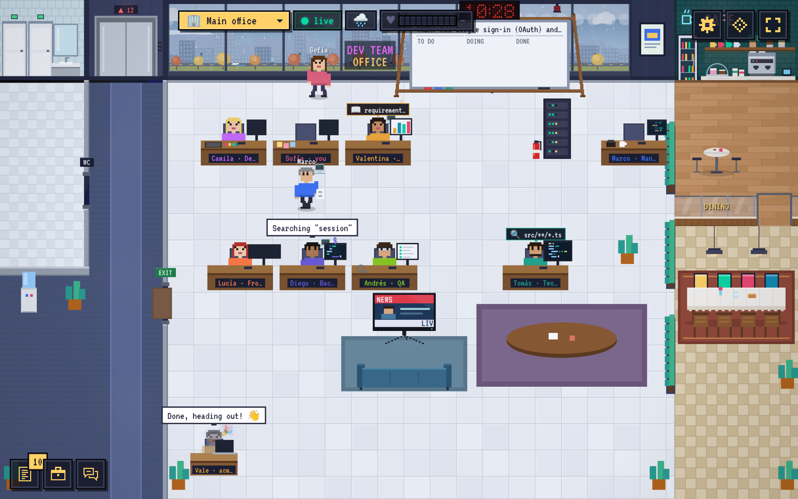
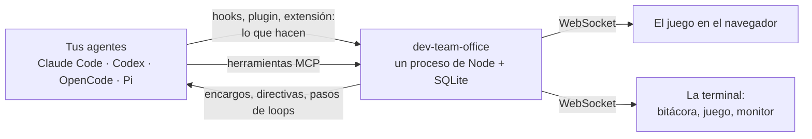
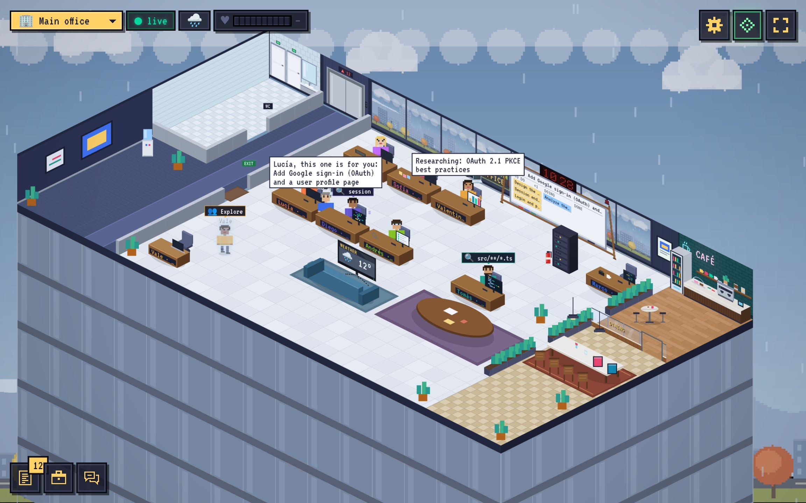
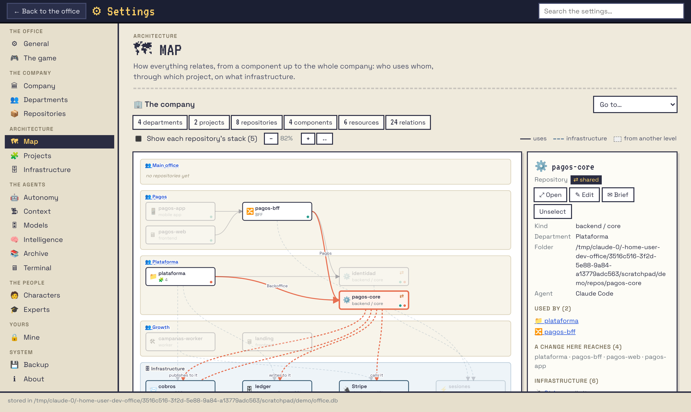

<div align="center">

# Dev Team Office

**Tus agentes de código, trabajando en una oficina en pixel art.**<br>
Mira a Claude Code, Codex, OpenCode y Pi como un equipo de desarrollo, y dales trabajo.

[](https://github.com/fmunoztorrent/dev-office/actions/workflows/test.yml)
[](https://github.com/fmunoztorrent/dev-office/releases/latest)
[](https://nodejs.org)
[](package.json)
[](LICENSE)

[English](README.md) · **Español**



</div>

Dev Team Office convierte lo que hace un agente de código en un equipo trabajando. Cada herramienta que usa, cada subagente, cada corrida de tests y cada error mueve a un personaje: QA corre los tests, backend edita el servidor, alguien nuevo sube por el ascensor cuando el agente lanza un subagente, y todo el equipo celebra cuando termina el turno. Haz clic en un personaje para preguntarle qué está haciendo; haz clic en la pizarra para darles trabajo.

**El juego es el frontend; el agente es el backend.** La oficina no ejecuta nada por su cuenta. Tus agentes hacen el trabajo, en sus propias sesiones, con sus propios logins y modelos, y se lo cuentan a la oficina con sus hooks, plugins o extensiones. La oficina lo dibuja, lleva el mapa de la empresa y les manda trabajo.

## Lo principal

- **En vivo, desde cada agente.** Claude Code y Codex (hooks), OpenCode (plugin), Pi (extensión) y cualquier agente con MCP. Cada subagente es un personaje propio. → [La oficina](docs/the-office.es.md)
- **Dales trabajo.** Un encargo desde la pizarra arranca el pipeline del propio harness (Errementari, comandos, prompts de Pi…). Una directiva desde el piso de la dirección llega a varios departamentos a la vez, después de mapear su impacto. Un loop trabaja un proyecto paso a paso hasta que cumple sus criterios. → [Hacer el trabajo](docs/work.es.md)
- **Modela tu empresa.** Departamentos, repositorios, proyectos y la infraestructura que comparten, dibujados como un mapa de la arquitectura que recorres desde la empresa entera hasta un componente. → [La empresa](docs/company.es.md)
- **Un archivo que leen los agentes.** Notas, decisiones y documentos, buscados por palabras y por significado, arriba de cada encargo. → [El archivo](docs/work.es.md#dos-pisos-más-la-dirección-y-el-archivo)
- **Tus pruebas E2E, miradas.** Una pantalla chica muestra el navegador bajo prueba, paso a paso, y repite cada prueba. → [Pruebas E2E](docs/e2e.es.md)
- **Cómoda en la terminal.** Una bitácora, el juego en medios bloques y, dentro de herdr, un monitor de actividad con cada agente y cada subagente en su pane. → [herdr](docs/herdr.es.md)
- **Local y liviana.** Un proceso de Node, un archivo SQLite y **ninguna dependencia en tiempo de ejecución**. En inglés o en español, en pixel art o anime, con el clima real de tu ciudad.

## Para empezar

Necesitas **Node.js ≥ 22.13** (macOS o Linux) y un agente de código.

```bash
curl -fsSL https://raw.githubusercontent.com/fmunoztorrent/dev-office/main/install.sh | sh
dev-team-office
```

El instalador deja `dev-team-office` en `~/.local/bin` (ofrece agregarlo a tu `PATH`) y **conecta cada agente que encuentra**: su integración en vivo, el servidor MCP y las skills. Después suma un proyecto: abre tu agente en él y pídele que **se una a la oficina** (`/mcp__dev-team-office__join` en Claude Code, `/office` en Pi), o corre ahí `dev-team-office join`. El juego está en <http://127.0.0.1:4317>.

| Otras formas | Comando |
|---|---|
| Probarla sin instalar | `npx github:fmunoztorrent/dev-office` |
| Con npm | `npm install -g github:fmunoztorrent/dev-office && dev-team-office setup` |
| Como plugin de Claude Code | `/plugin marketplace add fmunoztorrent/dev-office`, y después `/plugin install dev-team-office@dev-office` |
| Sólo las skills, en cualquier agente | `npx skills add fmunoztorrent/dev-office` |
| Desde el código | `git clone https://github.com/fmunoztorrent/dev-office && cd dev-office && node bin/dev-team-office.js setup` |

`dev-team-office doctor` revisa la instalación, `dev-team-office update` la actualiza y `dev-team-office uninstall` la quita. Paso a paso, con todas las formas de partir: [instalación](docs/installation.es.md).

## Agentes que soporta

| Agente | Actividad en vivo | Recibe trabajo | Herramientas MCP | Skills |
|---|---|:-:|:-:|:-:|
| Claude Code | hooks, o el plugin | ✓ | ✓ | ✓ |
| Codex | hooks | ✓ | ✓ | ✓ |
| OpenCode | plugin | ✓ | ✓ | ✓ |
| Pi | extensión (también sus subagentes) | ✓ | ✓ | ✓ |
| Gemini CLI · Cursor | — | — | ✓ | — |

Cualquier otro agente puede reportar por HTTP o WebSocket: ver [conectar un harness](docs/connect-a-harness.es.md).

## Cómo funciona



La oficina escucha sólo en `127.0.0.1` y en un socket Unix de tu usuario. Nada sale de tu máquina salvo lo que enciendas: el clima (Open-Meteo) y, si eliges uno, un modelo para dimensionar pedidos. Más: [cómo está hecha](docs/internals.es.md).

## Un vistazo

| La vista cenital (`v`) | El mapa de la arquitectura (⚙ › Mapa) |
|:-:|:-:|
|  |  |

## Documentación

| | |
|---|---|
| **Para empezar** | [Instalación](docs/installation.es.md) · [Uso](docs/usage.es.md) |
| **Guías** | [La oficina](docs/the-office.es.md) · [Hacer el trabajo](docs/work.es.md) · [La empresa](docs/company.es.md) · [Ajustes](docs/settings.es.md) · [herdr](docs/herdr.es.md) · [Pruebas E2E](docs/e2e.es.md) |
| **Para integrar** | [Integraciones](docs/integrations.es.md) · [Servidor MCP](docs/mcp.es.md) · [API HTTP](docs/api.es.md) · [Pipelines](docs/pipelines.es.md) · [Eventos por rol](docs/events-by-role.es.md) · [Conectar un harness](docs/connect-a-harness.es.md) |
| **Para contribuir** | [Cómo está hecha](docs/internals.es.md) · [Rendering](docs/rendering.es.md) · [Convenciones](docs/conventions.es.md) · [Contribuir](CONTRIBUTING.es.md) |

Cada documento está en inglés y en español (`.es.md`, al lado). El índice completo: [docs/](docs/README.es.md).

## Contribuir

Los issues y pull requests son bienvenidos. [CONTRIBUTING.es.md](CONTRIBUTING.es.md) cuenta cómo correrla desde el código, los tests (`npm test`) y las pocas reglas: ninguna dependencia en tiempo de ejecución, cada texto de la interfaz en los dos idiomas, cada cambio con su test. Los agentes de código que trabajan en este repositorio tienen su propia guía en [AGENTS.md](AGENTS.md).

Por favor sigue el [código de conducta](CODE_OF_CONDUCT.es.md). Preguntas: [SUPPORT.es.md](SUPPORT.es.md). Vulnerabilidades, en privado: [SECURITY.es.md](SECURITY.es.md). Qué cambió en cada versión: [CHANGELOG.md](CHANGELOG.md).

## Licencia

[MIT](LICENSE) © Fabián Muñoz
