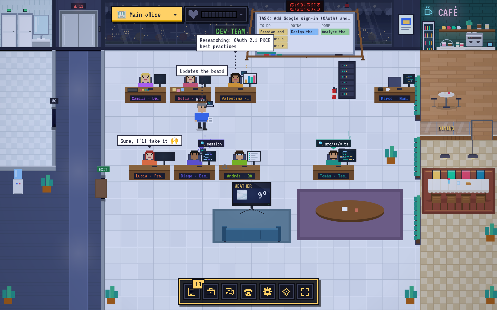
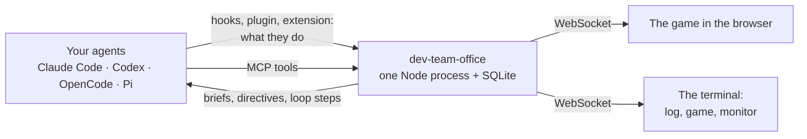
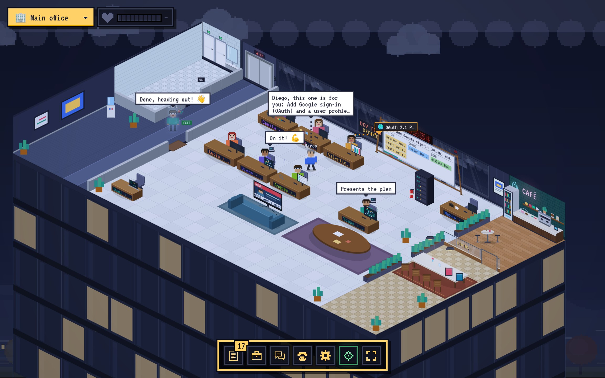
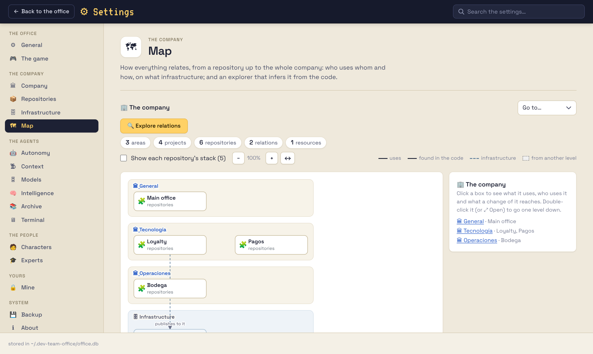

<div align="center">

# Dev Team Office

**Your coding agents, at work in a pixel-art office.**<br>
Watch Claude Code, Codex, OpenCode and Pi as a development team, and hand them work.

[](https://github.com/fmunoztorrent/dev-office/actions/workflows/test.yml)
[](https://github.com/fmunoztorrent/dev-office/releases/latest)
[](https://nodejs.org)
[](package.json)
[](LICENSE)

**English** · [Español](README.es.md)



</div>

Dev Team Office turns what a coding agent does into a team at work. Every tool call, subagent, test run and error moves a character: the QA runs the tests, the backend edits the server, a newcomer comes up the elevator when the agent launches a subagent, and the whole team celebrates when the turn ends. Click a character to ask them what they are doing; click the whiteboard to hand them work.

**The game is the frontend; the agent is the backend.** The office runs nothing on its own. Your agents do the work, in their own sessions, with their own logins and models, and tell the office through their hooks, plugins or extensions. The office draws it, keeps the company's map, and sends them work.

## Highlights

- **Live, from every agent.** Claude Code and Codex (hooks), OpenCode (plugin), Pi (extension) and any agent with MCP. Each subagent becomes a character of its own. → [The office](docs/the-office.md)
- **Hand them work.** A brief from the whiteboard starts the harness's own pipeline (Errementari, slash commands, Pi prompts…). A directive from the executive floor reaches several projects at once, after mapping its impact. Tell the manager what to do and it goes to work right away. A loop works a project step by step until its criteria are met. → [Getting work done](docs/work.md)
- **Model your company.** Areas, projects (each a floor with its people), their repositories, what each one uses of another — inferred from the code, not guessed — and the infrastructure they share (with what each one is for, where and how), drawn as an architecture map you walk from the whole company down to a repository. → [The company](docs/company.md)
- **An archive the agents read.** Notes, decisions and documents, searched by words and by meaning, on top of every brief. → [The archive](docs/work.md#two-more-floors-the-executive-one-and-the-archive)
- **Your E2E tests, watched.** A small screen shows the browser under test, step by step, and replays each test. → [E2E tests](docs/e2e.md)
- **At home in the terminal.** A log, the game in half blocks, and inside herdr an activity monitor with each agent and subagent in its own pane. → [herdr](docs/herdr.md)
- **Local and light.** One Node process, one SQLite file, **zero runtime dependencies**. English or Spanish, pixel art or anime, the real weather of your city.

## Quick start

You need **Node.js ≥ 22.13** (macOS or Linux) and a coding agent.

```bash
curl -fsSL https://raw.githubusercontent.com/fmunoztorrent/dev-office/main/install.sh | sh
dev-team-office
```

The installer puts `dev-team-office` in `~/.local/bin` (it offers to add it to your `PATH`) and **connects every agent it finds**: its live integration, the MCP server and the skills. Then add a project: open your agent in it and ask it to **join the office** (`/mcp__dev-team-office__join` in Claude Code, `/office` in Pi), or run `dev-team-office join` there. The game is at <http://127.0.0.1:4317>.

| Other ways | Command |
|---|---|
| Try it without installing | `npx github:fmunoztorrent/dev-office` |
| With npm | `npm install -g github:fmunoztorrent/dev-office && dev-team-office setup` |
| As a Claude Code plugin | `/plugin marketplace add fmunoztorrent/dev-office`, then `/plugin install dev-team-office@dev-office` |
| Only the skills, in any agent | `npx skills add fmunoztorrent/dev-office` |
| From source | `git clone https://github.com/fmunoztorrent/dev-office && cd dev-office && node bin/dev-team-office.js setup` |

`dev-team-office doctor` checks the installation, `dev-team-office update` updates it and `dev-team-office uninstall` removes it. Step by step, with every way to start it: [installation](docs/installation.md).

## Supported agents

| Agent | Live activity | Receives work | MCP tools | Skills |
|---|---|:-:|:-:|:-:|
| Claude Code | hooks, or the plugin | ✓ | ✓ | ✓ |
| Codex | hooks | ✓ | ✓ | ✓ |
| OpenCode | plugin | ✓ | ✓ | ✓ |
| Pi | extension (its subagents too) | ✓ | ✓ | ✓ |
| Gemini CLI · Cursor | — | — | ✓ | — |

Any other agent can report over HTTP or WebSocket: see [connecting a harness](docs/connect-a-harness.md).

## How it works



The office listens only on `127.0.0.1` and on a Unix socket of your user. Nothing leaves your machine except what you turn on: the weather (Open-Meteo) and, if you choose one, a model to size orders. More: [how it is built](docs/internals.md).

## A look around

| The isometric view (`v`) | The architecture map (⚙ › Map) |
|:-:|:-:|
|  |  |

## Documentation

| | |
|---|---|
| **Start** | [Installation](docs/installation.md) · [Usage](docs/usage.md) |
| **Guides** | [The office](docs/the-office.md) · [Getting work done](docs/work.md) · [The company](docs/company.md) · [Settings](docs/settings.md) · [herdr](docs/herdr.md) · [E2E tests](docs/e2e.md) |
| **Integrating** | [Integrations](docs/integrations.md) · [MCP server](docs/mcp.md) · [HTTP API](docs/api.md) · [Pipelines](docs/pipelines.md) · [Events by role](docs/events-by-role.md) · [Connecting a harness](docs/connect-a-harness.md) |
| **Contributing** | [How it is built](docs/internals.md) · [Rendering](docs/rendering.md) · [Conventions](docs/conventions.md) · [Contributing](CONTRIBUTING.md) |

Every document is in English and in Spanish (`.es.md`, next to it). The whole index: [docs/](docs/README.md).

## Contributing

Issues and pull requests are welcome. [CONTRIBUTING.md](CONTRIBUTING.md) covers running it from source, the tests (`npm test`) and the few rules: zero runtime dependencies, every interface text in both languages, every change with its test. Coding agents working on this repository have their own guide in [AGENTS.md](AGENTS.md).

Please follow the [code of conduct](CODE_OF_CONDUCT.md). Questions: [SUPPORT.md](SUPPORT.md). Vulnerabilities, privately: [SECURITY.md](SECURITY.md). What changed in each version: [CHANGELOG.md](CHANGELOG.md).

## License

[MIT](LICENSE) © Fabián Muñoz
