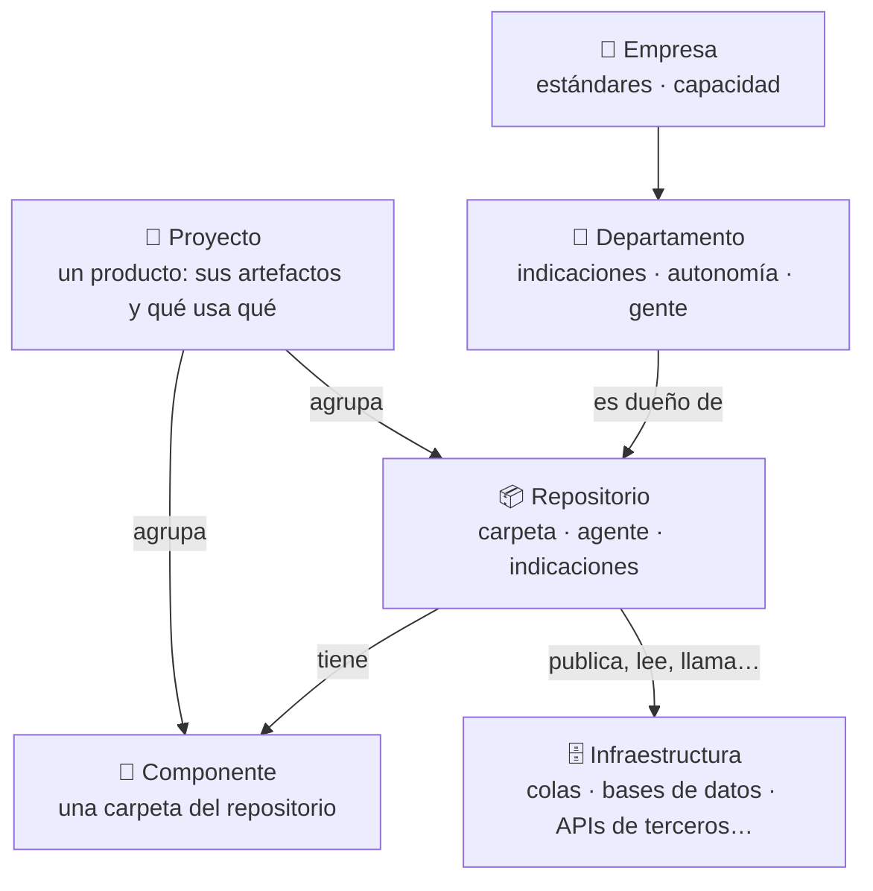

# La empresa

[English](company.md) · **Español**

Una oficina corriendo es una **empresa**. Esta guía cuenta cómo se organiza y cómo se relacionan sus piezas: departamentos, repositorios y sus componentes, proyectos (productos) y la infraestructura sobre la que corren. Todo se edita en los [ajustes](settings.es.md) y se ve junto en ⚙ › **Mapa**.

## Cómo encaja todo



| Pieza | Qué es | Dónde se edita |
|---|---|---|
| **Empresa** | La instancia entera. Sus estándares (los del CTO) van arriba de cada encargo | ⚙ › Empresa |
| **Departamento** | Un equipo, que el juego dibuja como un piso del edificio. Es **dueño** de repositorios: la actividad de sus agentes se ve en su piso | ⚙ › Departamentos |
| **Repositorio** | Una carpeta de tu disco más el agente (CLI) que la atiende. Es de un solo departamento | ⚙ › Repositorios |
| **Componente** | Una parte de un repositorio: el `apps/web` de un monorepo, la carpeta de un servicio. Se detecta de sus workspaces, o se declara | ⚙ › Repositorios |
| **Proyecto** | Un producto hecho de artefactos (repositorios, o componentes de uno) y lo que usa cada uno. Un encargo a él va en orden: primero lo que usan los demás | ⚙ › Proyectos |
| **Infraestructura** | Lo que el código usa y no es un repositorio: colas, tópicos, bases de datos, cachés, buckets, servicios de otros equipos, APIs de terceros, schedulers | ⚙ › Infraestructura |

Un repositorio tiene **un** departamento dueño, pero puede ser artefacto de proyectos de otros departamentos: entonces es **compartido** (⇄ en el mapa).

## Departamentos

Una instancia de la oficina es una **empresa**: le puedes ir agregando **departamentos** —cada uno una oficina del edificio (equipos o dominios: pagos, web, plataforma…)— en **⚙ › Departamentos**, desde el diálogo de directivas en la dirección, o con `dev-team-office departments add`. Cada departamento tiene:

- **sus proyectos** (repositorios, cada uno con su agente: `--office` o el selector en ⚙ › Repositorios; el mantenedor también puede traer un proyecto que ya existe);
- **sus indicaciones**: cómo se trabaja ahí (convenciones, lo que nunca se hace, a quién preguntar). Van arriba de cada encargo, pipeline, directiva y pregunta a sus proyectos, como las de un proyecto de ChatGPT o Claude;
- **su autonomía**: guiada (la analista revisa cada encargo y el agente te pregunta cuando tiene dudas), equilibrada (revisa y después el agente trabaja hasta terminar) o autónoma (sin revisión); si no, la de la empresa (⚙ › Autonomía);
- **su personal**: sus personajes (nombres, cargos, personalidades, estilos y colores propios);
- **su zona horaria** (opcional: si no, la de la empresa; si no, la del sistema operativo), y con ella su hora, su almuerzo, su día y su noche, su estación y **su clima**. Un departamento es un equipo; el juego lo dibuja como una oficina, pero no necesita un lugar propio;
- **su actividad**: cada evento de un agente va a su oficina — la que dice el propio agente (la oficina se la pasa al abrirlo), la de su sesión, la de su pane de herdr o la del agente registrado cuya ruta contiene su carpeta; si no, a la principal.

**La empresa tiene sus estándares** (los del CTO, en ⚙ › Empresa): lo que siguen todos los proyectos de todos los departamentos (convenciones, seguridad, cómo documentar). Van primero, antes de las indicaciones del departamento y del proyecto.

**Cada proyecto también tiene sus indicaciones** (⚙ › Repositorios, `dev-team-office agents set <id> --instructions "…"` o `update_project` por MCP), para todos los agentes que trabajan en su carpeta: los comandos, las convenciones, lo que no se toca. Un encargo a esa carpeta empieza así (la oficina saca esa cabecera del título de la pizarra):

```
📁 Trabaja sólo dentro de ~/tienda: …
📋 Estándares de la empresa (los del CTO):
│ Commits convencionales. Cada endpoint documentado en OpenAPI.
📋 Indicaciones del departamento «Pagos»:
│ Montos siempre en centavos. Nunca registres números de tarjeta.
📋 Indicaciones del proyecto «tienda»:
│ pnpm, no npm. Corre pnpm test antes de terminar.

Agrega paginación a la lista de pedidos
```

Las interfaces muestran **una oficina a la vez**: la que eliges en el selector de **arriba a la izquierda** (la web y la terminal; también con `o`). La elección queda guardada. La bitácora de la terminal muestra la actividad de todas.

## Repositorios: cada uno con su agente (su harness engineering)

Un **repositorio** es una ruta completa más el agente (CLI) que la atiende (Claude Code, OpenCode o Pi). Se registra en **⚙ › Repositorios** (o con `dev-team-office agents add`) y se guarda en la base SQLite de la oficina. Lo que trae esa ruta es del agente: su orquestador, sus subagentes, sus comandos, sus pipelines. La oficina lo **detecta** y, al mandarle un prompt, arranca **ese** pipeline:

| Lo que trae la ruta | Pipelines que ofrece | Cómo se arranca |
|---|---|---|
| [Errementari](https://github.com/fmunoztorrent/errementari) (`.errementari.json`) | `/task` (clasifica solo), feature, bugfix, chore, debug | `/task <prompt>` (`/task bug: …`, `/task chore: …`): el agente `pipeline` lo pasa por spec → architect → qa → backend/frontend → qa → close |
| Comandos de Claude Code (`.claude/commands/*.md`) | `/<comando>` | `claude -p "/<comando> <prompt>"` |
| Comandos de OpenCode (`opencode.json`, `.opencode/command/`) | `/<comando>` | `opencode run --command <comando> "<prompt>"` |
| Prompts de Pi (`.pi/prompts`, `~/.pi/agent/prompts`, p. ej. los de gentle-pi) | `/<prompt>` | `pi -p "/<prompt> <prompt>"` |
| Pipelines de Dev Team Office (`.devteam/pipelines`) | `Pipeline · <nombre>` | Los corre una sesión abierta, dentro de sí misma ([docs/pipelines.es.md](pipelines.es.md)) |
| Cualquier ruta | Prompt directo | El prompt tal cual, para el agente por defecto del harness |

**A dónde va el prompt:**

- **Sesión abierta en esa ruta.**
  - Pi y OpenCode lo reciben al instante: Pi expande el `/comando` y OpenCode lo corre con `session.command`.
  - Claude Code lo recibe en su hook `Stop`, con el comando expandido.
- **Sesión nueva.** Dentro de herdr, el agente se abre en un pane nuevo y recibe el prompt ahí. Fuera de herdr, la oficina abre el CLI del agente en su ruta, sin shell y con el prompt como un único argumento. Los hooks y plugins del agente reportan todo a la oficina.

**Qué personaje hace cada subagente:** el de su `role:` (en el frontmatter de su archivo, o `role = "…"` en el TOML de Codex); si no lo declara, el de su nombre (`qa`, `architect`, `sdd-apply`…) y, si tampoco, el que sugiere su descripción («Runs the e2e tests» → QA). Los del proyecto ganan sobre los globales (`~/.claude/agents`, `~/.pi/agent/agents`…), y cada sesión que trabaja en esa carpeta lo aprende sola, aunque su agente no lo diga. `join` (o `detect_project`) muestra el equipo y cuáles no calzan con ningún rol.

Cuando el orquestador delega, el personaje que se mueve es el de ese subagente:

- **Errementari:** spec → analista, architect → Tech Lead, qa → QA, backend → backend, pipeline → manager.
- **gentle-pi:** `subagent_run`, con sdd-* y review-*.

## Proyectos: un producto y sus artefactos

Una empresa no trabaja en repos, trabaja en productos: «Pagos» es su **core**, su **BFF** y su **front en Next.js**, quizás tres repos. En **⚙ › Proyectos** cada producto es un **proyecto**:

- **sus artefactos:** cada uno es un repo registrado, o un componente de uno (el `apps/web` de un monorepo), **con su carpeta a la vista** (`~/code/pagos-core`, `~/code/monorepo/apps/web`), con **su tipo** (frontend, app móvil, BFF, backend/core, worker, librería, datos, infraestructura: se detecta de su carpeta, o el que digas) y **lo que usa** (el BFF usa el core; el front, el BFF). **↻ Proponer** llena las dos cosas;
- **su equipo:** el departamento que responde por él, o **un equipo propio** (un departamento nuevo, y sus repos se van a él): si cada proyecto tiene su squad, cada uno tiene su piso y su gente. Un repo tiene un departamento dueño (su gente hace su trabajo), pero puede ser artefacto de sistemas de otros departamentos: un core **compartido**;
- **sus indicaciones**, arriba de cada encargo de sus artefactos, bajo una línea que dice qué es el artefacto: `🧩 Artefacto bff (BFF) del sistema Pagos · usa core · lo usan web`.

**Un encargo a un sistema** (🧩 en la lista de la pizarra, ✉ Encargo en su tarjeta, `POST /v1/systems/<id>/brief`, o eligiéndolo en la dirección) **va en orden**: primero lo que otros usan (core → bff → web). Cada artefacto parte cuando terminan los que usa, lleva **su traspaso** (lo que dejaron con la herramienta MCP `handoff`: qué cambió en lo que exponen; o el final de su respuesta) y puede leer sus carpetas sin cambiarlas. Si uno de ellos falla, los que lo usan no parten.

**El impacto de una directiva sigue las dependencias:** cambiar el core trae al BFF y al front que lo usan («usa core, que cambia»), y nombrar el sistema trae a todos sus artefactos. Y **el tipo decide quién hace el código que ninguna regla reclama:** el `src/lib/money.ts` de un repo frontend es del frontend; el de uno de infraestructura, de DevOps.

## Infraestructura

Colas, tópicos, bases de datos, cachés, buckets, servicios de otros equipos, APIs de terceros, schedulers y repositorios que la oficina no tiene. La oficina los conoce de dos maneras:

- **Detectados** en la carpeta de cada repositorio: sus dependencias (`pg`, `kafkajs`, `stripe`…), los servicios de su `docker-compose` y los recursos que nombra su Terraform (`aws_sqs_queue "refunds"`). Una tecnología sola (PostgreSQL, Kafka) es el **stack** del repositorio; un recurso con nombre se ofrece para declararlo.
- **Declarados** en ⚙ › Infraestructura (o por un agente, con la herramienta MCP `declare_resource`): su tipo, su nombre, sobre qué corre (SQS, PostgreSQL, Stripe…), dónde vive (una cuenta, un cluster, una URL), notas, si existe o está **por crear**, y **quién lo usa y cómo**: cada repositorio con su verbo (lo usa, publica, consume, lee, escribe, llama, programa, es dueño).

En la tarjeta de cada recurso vinculas o desvinculas un repositorio ahí mismo; **Editar** abre el formulario entero. Un pedido que nombra un recurso llega a los repositorios que lo usan (ver [dimensionar un pedido](work.es.md#dimensionar-un-pedido-su-árbol-su-grafo-y-lo-que-no-está-en-el-mapa)).

## El mapa de la arquitectura

⚙ › **Mapa** dibuja todo lo anterior como un solo diagrama que recorres nivel por nivel:


| Nivel | Qué muestra |
|---|---|
| **La empresa** | Un carril por departamento con sus repositorios, quién usa a quién entre ellos, y abajo un carril con la infraestructura |
| **Un departamento** | Sus repositorios y, punteado, sólo lo que usan o lo que los usa en otros departamentos |
| **Un proyecto** | Sus artefactos con su turno (el orden en que va un cambio), cada uno en el carril del departamento dueño, y la infraestructura de sus repositorios |
| **Un repositorio** | Sus componentes y lo que usa cada uno, los repositorios de alrededor y su stack |

- **Las flechas continuas** son *usa* (desde un proyecto: la web usa el BFF). **Las punteadas** van a la infraestructura, con el cómo (*publica en ella*, *la lee*…). Los puntos de color de un repositorio son los proyectos de los que es parte; ⇄ marca uno compartido.
- **Haz clic en una caja** para ver qué usa, quién la usa, **hasta dónde llega un cambio suyo** (cerca y lejos), su infraestructura y sus proyectos; lo demás se atenúa. **Doble clic** (o ⤢ Abrir) baja un nivel; las migas y **Ir a…** llevan a cualquier parte.
- Desde el panel, **Editar** abre el formulario de eso (un departamento, un repositorio, un proyecto, un recurso) y ✉ **Encargo** le manda trabajo a un repositorio o a un proyecto.
- **Mostrar el stack de cada repositorio** suma las tecnologías encontradas en cada carpeta. El diagrama se ajusta solo al ancho hasta que cambias el zoom a mano.

Bajo el diagrama, la **revisión** lista lo que merece una mirada, lo grave primero:

| Hallazgo | Por qué importa |
|---|---|
| Una cola o un tópico en que algo publica y nada consume (o al revés) | Los mensajes se acumulan, o un consumidor espera para siempre |
| Un recurso declarado que nadie usa | El mapa no puede saber a quién llega un pedido sobre él |
| Un repositorio cuya carpeta ya no está | Sus encargos no pueden correr |
| Un artefacto sin repositorio registrado, o un proyecto cuyos artefactos se usan en círculo | El proyecto no tiene un orden en que ir |
| Un repositorio en ningún proyecto (cuando ya hay proyectos) | Nada dice qué usa ni quién lo usa |
| Un repositorio compartido entre departamentos, un recurso por crear, uno encontrado en un repositorio y sin declarar, un departamento sin repositorios | Notas, para que el mapa diga la verdad |

Los agentes leen el mismo mapa con la herramienta MCP [`get_architecture`](mcp.es.md), y otros programas con [`GET /v1/architecture`](api.es.md#la-arquitectura).
