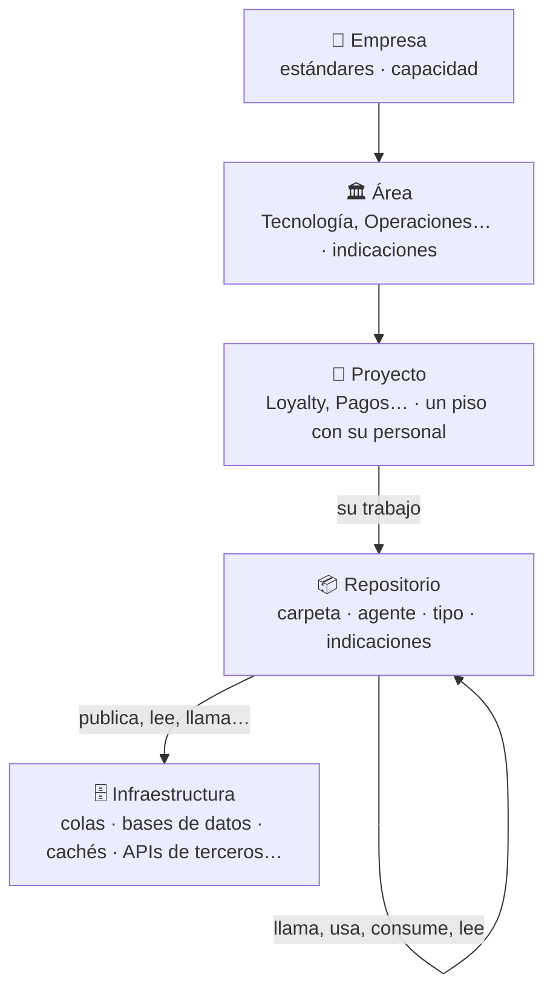
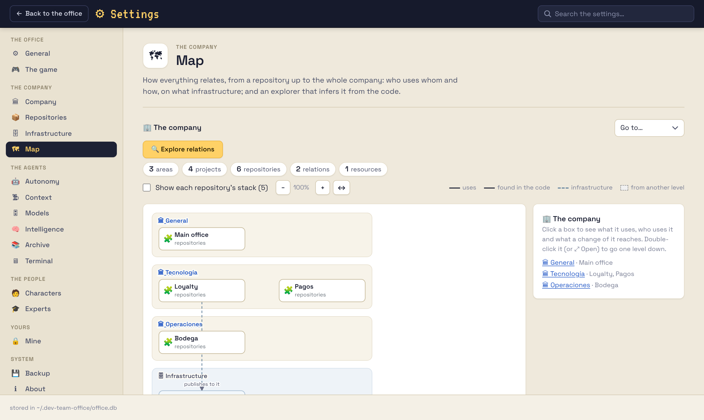

# La empresa

[English](company.md) · **Español**

Una oficina corriendo es una **empresa**. Esta guía cuenta cómo se organiza y cómo se relacionan sus piezas: áreas, proyectos, repositorios, las relaciones entre ellos y la infraestructura sobre la que corren. Todo se edita en los [ajustes](settings.es.md) (⚙ › **Empresa**, **Repositorios**, **Infraestructura**) y se ve junto en ⚙ › **Mapa**.

## Cómo encaja todo



| Pieza | Qué es | Dónde se edita |
|---|---|---|
| **Empresa** | La instancia entera. Sus estándares (los del CTO) van arriba de cada encargo | ⚙ › Empresa |
| **Área** | Un grupo de proyectos (Tecnología, Operaciones…). Sus indicaciones van arriba de cada encargo de sus proyectos. Siempre hay una **General** | ⚙ › Empresa |
| **Proyecto** | Un producto o iniciativa (Loyalty, Pagos): se dibuja como **un piso del edificio con su personal** (los personajes trabajan para el proyecto), con sus indicaciones, su autonomía y su zona horaria | ⚙ › Empresa |
| **Repositorio** | Una carpeta de tu disco más el agente (CLI) que la atiende, y su tipo (frontend, BFF, backend…). Pertenece a **un** proyecto, que eliges siempre tú | ⚙ › Repositorios |
| **Relación** | Lo que un repositorio usa de otro: el BFF *llama* al core, un worker *consume* lo que otro publica. Lo dices tú, o el explorador lo encuentra en el código | ⚙ › Mapa, o la ventana del repositorio |
| **Infraestructura** | Lo que el código usa o con lo que habla y no es un repositorio: colas, tópicos, bases de datos, cachés, buckets, servicios de otros equipos, APIs de terceros, schedulers | ⚙ › Infraestructura |

Un repositorio pertenece a un proyecto, pero otro proyecto puede usarlo (un core compartido): en el mapa sale en los dos, marcado con ⇄.

## Áreas y proyectos

**⚙ › Empresa** tiene todo lo de la forma de la empresa en un solo lugar: sus estándares y su capacidad, y sus **áreas**, cada una con sus **proyectos**. Desde la tarjeta de un proyecto le agregas un repositorio (abre la ventana del repositorio con el proyecto ya elegido), vas a su piso, editas su personal (⚙ › Personajes), lo abres en el mapa o le mandas un encargo.

Cada proyecto tiene:

- **sus repositorios** (cada uno con su agente) y, por ellos, su infraestructura;
- **su personal**: sus personajes (sus propios nombres, cargos, personalidades, estilos y colores): el equipo del proyecto;
- **sus indicaciones**: cómo se trabaja ahí (convenciones, lo que nunca se hace, a quién preguntar). Van arriba de cada encargo, pipeline, directiva y pregunta a sus repositorios, como las de un proyecto de ChatGPT o de Claude;
- **su autonomía**: guiada (la analista revisa cada encargo y el agente te pregunta cuando duda), equilibrada (revisa, y después el agente trabaja hasta el final) o autónoma (sin revisión); si no, la de la empresa (⚙ › Autonomía);
- **su zona horaria** (opcional: si no, la de la empresa), y con ella su hora, su almuerzo, su día y su noche, su estación y **su clima**;
- **su actividad**: cada evento de un agente va a su proyecto: el que dice el propio agente, el de su sesión, el de su pane de herdr o el del repositorio registrado cuya ruta contiene su carpeta; si no, al principal.

**La empresa tiene sus estándares** (los del CTO): lo que sigue todo repositorio (convenciones, seguridad, cómo documentar). Van primero; después, las indicaciones del área, del proyecto y del repositorio. Un encargo empieza así (la oficina saca esta cabecera del título de la pizarra):

```
📁 Trabaja sólo dentro de ~/loyalty-core: …
📋 Estándares de la empresa (los del CTO):
│ Commits convencionales. Cada endpoint documentado en OpenAPI.
📋 Indicaciones del área «Tecnología»:
│ Todo cambio con su prueba.
📋 Indicaciones del proyecto «Loyalty»:
│ Los puntos nunca bajan de cero.
🧩 Artefacto loyalty-core (backend / core) del proyecto Loyalty · lo usa loyalty-bff
📋 Indicaciones del repositorio «loyalty-core»:
│ pnpm, no npm. Corre pnpm test antes de terminar.

Agrega un endpoint de vencimiento de puntos
```

Las interfaces muestran **el piso de un proyecto a la vez**: el que eliges en el selector **arriba a la izquierda** (web y terminal; también con `o`). La bitácora de la terminal muestra la actividad de todos. La CLI todavía llama `departments` a los proyectos (`dev-team-office departments add`), y la API, `offices`.

**Antes de esta versión** una empresa tenía departamentos y «sistemas» (productos que agrupaban repositorios). Cuando la oficina abre una base de antes, convierte cada sistema en un proyecto propio (en un área con el nombre de su departamento cuando el departamento tenía varios), sus partes en relaciones entre repositorios, y no se pierde nada.

## Repositorios: cada uno con su agente (su harness engineering)

Un **repositorio** es una ruta completa más el agente (CLI) que la atiende (Claude Code, OpenCode o Pi), su tipo (detectado de su carpeta, o el que digas) y **el proyecto al que pertenece, que eliges siempre tú** (nunca cae en uno por sí solo). Se registra en **⚙ › Repositorios** (una fila liviana cada uno, agrupados por área y proyecto; sus detalles se abren en su propia ventana) o con `dev-team-office agents add`, y se guarda en la base SQLite de la oficina. Lo que trae esa ruta es del agente: su orquestador, sus subagentes, sus comandos, sus pipelines. La oficina lo **detecta** y, al mandarle un prompt, arranca **ese** pipeline:

| Lo que trae la ruta | Pipelines que ofrece | Cómo se arranca |
|---|---|---|
| [Errementari](https://github.com/fmunoztorrent/errementari) (`.errementari.json`) | `/task` (clasifica solo), feature, bugfix, chore, debug | `/task <prompt>` (`/task bug: …`, `/task chore: …`): el agente `pipeline` lo pasa por spec → architect → qa → backend/frontend → qa → close |
| Comandos de Claude Code (`.claude/commands/*.md`) | `/<comando>` | `claude -p "/<comando> <prompt>"` |
| Comandos de OpenCode (`opencode.json`, `.opencode/command/`) | `/<comando>` | `opencode run --command <comando> "<prompt>"` |
| Prompts de Pi (`.pi/prompts`, `~/.pi/agent/prompts`, p. ej. los de gentle-pi) | `/<prompt>` | `pi -p "/<prompt> <prompt>"` |
| Pipelines de Dev Team Office (`.devteam/pipelines`) | `Pipeline · <nombre>` | Los corre una sesión abierta, dentro de sí misma ([docs/pipelines.es.md](pipelines.es.md)) |
| Cualquier ruta | Prompt directo | El prompt tal cual, para el agente por defecto del harness |

**A dónde va el prompt:**

- **Sesión abierta en esa ruta.**
  - Pi y OpenCode lo reciben al instante: Pi expande el `/comando` y OpenCode lo corre con `session.command`.
  - Claude Code lo recibe en su hook `Stop`, con el comando expandido.
- **Sesión nueva.** Dentro de herdr, el agente se abre en un pane nuevo y recibe el prompt ahí. Fuera de herdr, la oficina abre el CLI del agente en su ruta, sin shell y con el prompt como un único argumento. Los hooks y plugins del agente reportan todo a la oficina.

**Qué personaje hace cada subagente:** el de su `role:` (en el frontmatter de su archivo, o `role = "…"` en el TOML de Codex); si no lo declara, el de su nombre (`qa`, `architect`, `sdd-apply`…) y, si tampoco, el que sugiere su descripción («Runs the e2e tests» → QA). Los del proyecto ganan sobre los globales (`~/.claude/agents`, `~/.pi/agent/agents`…), y cada sesión que trabaja en esa carpeta lo aprende sola, aunque su agente no lo diga. `join` (o `detect_project`) muestra el equipo y cuáles no calzan con ningún rol.

Cuando el orquestador delega, el personaje que se mueve es el de ese subagente:

- **Errementari:** spec → analista, architect → Tech Lead, qa → QA, backend → backend, pipeline → manager.
- **gentle-pi:** `subagent_run`, con sdd-* y review-*.

## Relaciones entre repositorios

Lo que un repositorio usa de otro (el BFF **llama** a la API del core, un worker **consume** lo que otro publica, un front **usa** una librería, un job **lee** los datos de otro) es una **relación**. La dices en el mapa (🔗 Relacionar, y un clic en la otra caja), en la ventana del repositorio (*Qué usa de otros repositorios*) o con `POST /v1/relations`. Una relación dentro de un proyecto no puede cerrar un círculo.

**🔍 Explorar relaciones** (en el mapa, y en la revisión cuando un repositorio no tiene ninguna) lee las carpetas de los repositorios registrados y las deduce **sin modelo**: código, no tokens:

- un repositorio que llama a `localhost:<puerto>` (o a un servicio de un `docker-compose`) de otro que escucha ahí;
- una variable de entorno con el nombre de otro repositorio (`LOYALTY_CORE_URL`);
- una dependencia al paquete de otro repositorio (`"@acme/core"`);
- `depends_on` en un `docker-compose`;
- uno que publica en una cola o tópico que otro consume.

Lo que encuentra se dibuja **punteado**, con su evidencia (`src/index.js:1 const CORE = process.env.LOYALTY_CORE_URL…`): confírmala (✓) y pasa a ser tuya, o quítala. Una que dijiste tú nunca la reemplaza una encontrada.

**Un encargo a un proyecto** (🧩 en la lista de la pizarra, ✉ Encargo en su tarjeta, o eligiéndolo en el piso ejecutivo) **va en orden**: primero lo que otros usan (core → BFF → web). Cada repositorio parte cuando terminan los que usa, lleva **su traspaso** (lo que dejaron con la herramienta MCP `handoff`, o el final de su respuesta) y puede leer sus carpetas sin cambiarlas. Si uno falla, los que lo usan no parten.

**El impacto de una directiva sigue las relaciones:** cambiar el core trae al BFF y al front que lo usan, y nombrar el proyecto trae a todos sus repositorios. Y **el tipo decide quién hace el código que ninguna regla reclama:** el `src/lib/money.ts` de un repo frontend es del frontend; el de uno de infraestructura, de DevOps.

## Infraestructura

Colas, tópicos, bases de datos, cachés, buckets, servicios de otros equipos, APIs de terceros, schedulers y repositorios que la oficina no tiene. La oficina los conoce de dos maneras:

- **Detectados** en la carpeta de cada repositorio: sus dependencias (`pg`, `kafkajs`, `stripe`…), los servicios de su `docker-compose` y los recursos que nombra su Terraform (`aws_sqs_queue "refunds"`). Una tecnología sola (PostgreSQL, Kafka) es el **stack** del repositorio; un recurso con nombre se ofrece para declararlo.
- **Declarados** en ⚙ › Infraestructura (o por un agente, con la herramienta MCP `declare_resource`): su tipo, su nombre, sobre qué corre (SQS, PostgreSQL, Stripe…), dónde vive (una cuenta, un cluster, una URL), notas, si existe o está **por crear**, y **quién lo usa y cómo**: cada repositorio con su verbo (lo usa, publica, consume, lee, escribe, llama, programa, es dueño).

**Para qué, dónde y cómo.** Una tecnología detectada dice cómo la usa cada repositorio, leído de su código: **para qué** (sesiones, una cola de trabajos, pub/sub, limitar el tráfico, una caché, tablas…), **dónde** se configura (`src/server.js:2 new Redis(process.env.REDIS_URL)`) y **con qué librería** (`package.json: ioredis`), cada cosa con su archivo y línea. Haz clic en ella en ⚙ › Infraestructura, o en su caja del mapa (`GET /v1/resources/explain?repo=&tech=`).

En la tarjeta de cada recurso vinculas o desvinculas un repositorio ahí mismo; **Editar** abre el formulario entero. Un pedido que nombra un recurso llega a los repositorios que lo usan (ver [dimensionar un pedido](work.es.md#dimensionar-un-pedido-su-árbol-su-grafo-y-lo-que-no-está-en-el-mapa)).

## El mapa de la arquitectura

⚙ › **Mapa** dibuja todo lo anterior como un solo diagrama que se recorre nivel por nivel:



| Nivel | Qué muestra |
|---|---|
| **La empresa** | Un carril por área con sus proyectos, y qué proyecto usa a cuál (por sus repositorios) |
| **Un área** | Sus proyectos con sus repositorios, y lo que usan de otras áreas |
| **Un proyecto** | Sus repositorios con su turno (el orden en que va un cambio), los de otros proyectos que usan (⇄) y su infraestructura |
| **Un repositorio** | Los repositorios que usa y los que lo usan, con cómo, y su infraestructura (y su stack, si lo pides) |

- **Las flechas sólidas** son relaciones que dijiste (con cómo: *llama*, *usa*, *consume*, *lee*); **las punteadas** las encontró el explorador, o van a la infraestructura (*publica*, *lee*…).
- **Un clic en una caja** muestra qué usa, quién la usa, **hasta dónde llega un cambio suyo** (cerca y lejos), su infraestructura, su proyecto y su área; lo demás se apaga. **Doble clic** (o ⤢ Abrir) baja un nivel; las migas y **Ir a…** llevan a cualquier parte.
- **🔗 Relacionar** (en el panel de un repositorio) y un clic en la otra caja dice qué usa; **🔍 Explorar relaciones** las deduce del código; en una encontrada, **✓** la confirma.
- En el panel de un recurso, **cómo lo usa cada repositorio**: para qué, dónde y con qué librería, de su código.
- Desde el panel, **Editar** abre el formulario de eso (un área, un proyecto, un repositorio, un recurso) y ✉ **Encargo** manda trabajo a un repositorio o a un proyecto.

Bajo el diagrama, la **revisión** lista lo que merece una mirada, lo grave primero:

| Hallazgo | Por qué importa |
|---|---|
| Una cola o tópico donde algo publica y nada consume (o al revés) | Los mensajes se acumulan, o un consumidor espera para siempre |
| Un recurso declarado al que nadie está vinculado | El mapa no puede decir a quién llega un pedido sobre él |
| Un repositorio cuya carpeta ya no está | Sus encargos no pueden correr |
| Un proyecto cuyos repositorios se usan en círculo | Su encargo no tiene orden en que ir |
| Un proyecto con varios repositorios y ninguna relación entre ellos | Nada dice cómo va un cambio: 🔍 explóralas |
| Una relación encontrada en el código y no confirmada | Puede estar bien o no: confírmala o quítala |
| Un repositorio que usan otros proyectos, un recurso por crear, uno encontrado en un repositorio y no declarado, un proyecto sin repositorios | Notas, para que el mapa diga la verdad |

Los agentes leen el mismo mapa con la herramienta MCP [`get_architecture`](mcp.es.md), tú en una terminal con `dev-team-office architecture` (un esquema en tu idioma; `--json`, el grafo entero), y otros programas con [`GET /v1/architecture`](api.es.md#la-arquitectura).
