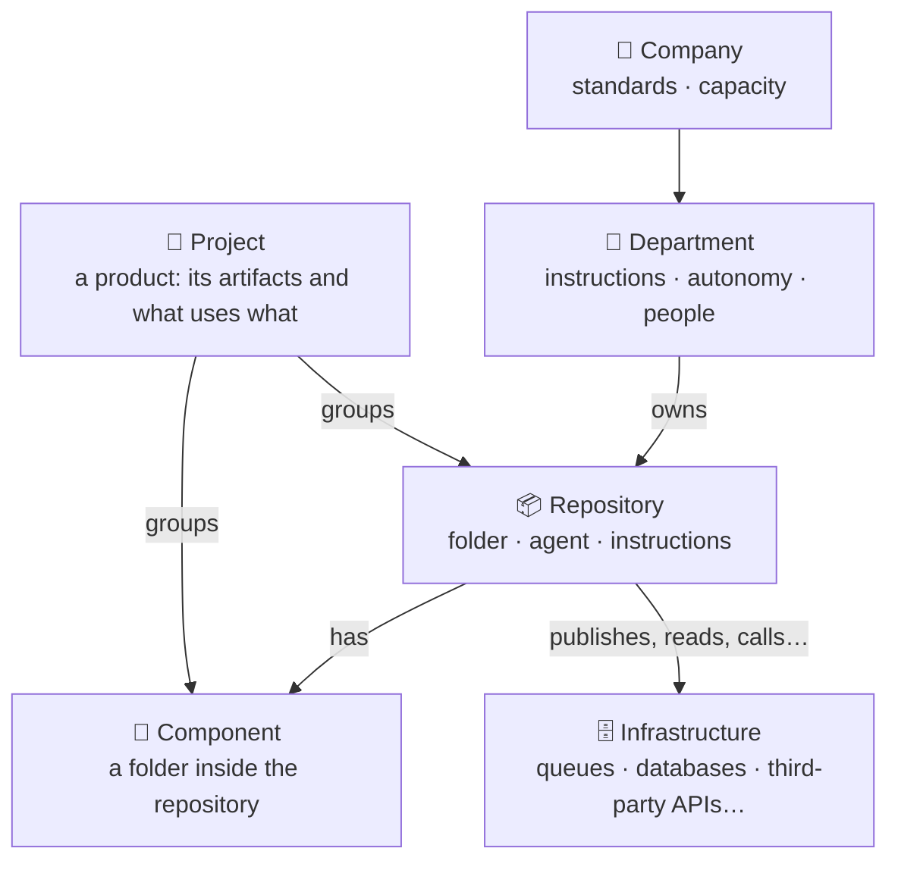

# The company

**English** · [Español](company.es.md)

One running office is a **company**. This guide covers how it is organized and how its pieces relate: departments, repositories and their components, projects (products) and the infrastructure they run on. You edit all of it in the [settings](settings.md) and see it together in ⚙ › **Map**.

## How it fits together



| Piece | What it is | Where you edit it |
|---|---|---|
| **Company** | The whole instance. Its standards (the CTO's) go on top of every brief | ⚙ › Company |
| **Department** | A team, drawn as a floor of the building. It **owns** repositories: their agents' activity shows on its floor | ⚙ › Departments |
| **Repository** | A folder on your disk plus the agent (CLI) that serves it. It belongs to exactly one department | ⚙ › Repositories |
| **Component** | A part of a repository: a monorepo's `apps/web`, a service's folder. Detected from its workspaces, or declared | ⚙ › Repositories |
| **Project** | A product made of artifacts (repositories, or components of one) and what each one uses. A brief to it goes in order: what the others use goes first | ⚙ › Projects |
| **Infrastructure** | What the code runs on or talks to and is not a repository: queues, topics, databases, caches, buckets, other teams' services, third-party APIs, schedulers | ⚙ › Infrastructure |

A repository has **one** owner department, but it can be an artifact of other departments' projects: it is then **shared** (⇄ on the map).

## Departments

One office instance is a **company**: you can keep adding **departments** — each one an office of the building (teams or domains: payments, web, platform…) — in **⚙ › Departments**, from the directive dialog on the executive floor, or with `dev-team-office departments add`. Each department has:

- **its projects** (repositories, each with its agent: `--office` or the selector in ⚙ › Repositories; the maintainer can also bring an existing project into it);
- **its instructions**: how to work there (conventions, what is never done, who to ask). They go on top of every brief, pipeline, directive and question to its projects, like a ChatGPT or Claude project's;
- **its autonomy**: guided (the analyst reviews each brief and the agent asks you when in doubt), balanced (it reviews, then the agent works to the end) or autonomous (no review); otherwise the company's (⚙ › Autonomy);
- **its people**: its characters (their own names, titles, personalities, styles and colors);
- **its time zone** (optional: otherwise the company's; otherwise the system's), and with it its time, its lunch, its day and night, its season and **its weather**. A department is a team; the game draws it as an office, but it does not need a place of its own;
- **its activity**: each agent event goes to its office — the one the agent itself states (the office passes it when opening it), its session's, its herdr pane's, or the one of the registered agent whose path contains its folder; otherwise, the main one.

**The company has its standards** (the CTO's, in ⚙ › Company): what every project of every department follows (conventions, security, how to document). They go first, before the department's and the project's instructions.

**Each project has instructions too** (⚙ › Repositories, `dev-team-office agents set <id> --instructions "…"`, or `update_project` over MCP), for every agent working in its folder: the commands, the conventions, what not to touch. A brief to that folder starts like this (the office takes this header out of the whiteboard's title):

```
📁 Work only inside ~/shop: …
📋 The company’s standards (the CTO’s):
│ Conventional commits. Every endpoint documented in OpenAPI.
📋 Instructions of the department «Payments»:
│ Every amount in cents. Never log card numbers.
📋 Instructions of the project «shop»:
│ pnpm, not npm. Run pnpm test before finishing.

Add pagination to the orders list
```

The interfaces show **one office at a time**: the one you pick in the selector at the **top left** (web and terminal; also with `o`). The choice is saved. The terminal log shows the activity of all of them.

## Repositories: each one with its agent (its harness engineering)

A **repository** is a full path plus the agent (CLI) that serves it (Claude Code, OpenCode or Pi). It is registered in **⚙ › Repositories** (or with `dev-team-office agents add`) and saved in the office's SQLite database. What that path brings belongs to the agent: its orchestrator, its subagents, its commands, its pipelines. The office **detects** it and, when sending it a prompt, starts **that** pipeline:

| What the path brings | Pipelines it offers | How it starts |
|---|---|---|
| [Errementari](https://github.com/fmunoztorrent/errementari) (`.errementari.json`) | `/task` (classifies by itself), feature, bugfix, chore, debug | `/task <prompt>` (`/task bug: …`, `/task chore: …`): the `pipeline` agent runs it through spec → architect → qa → backend/frontend → qa → close |
| Claude Code commands (`.claude/commands/*.md`) | `/<command>` | `claude -p "/<command> <prompt>"` |
| OpenCode commands (`opencode.json`, `.opencode/command/`) | `/<command>` | `opencode run --command <command> "<prompt>"` |
| Pi prompts (`.pi/prompts`, `~/.pi/agent/prompts`, e.g. gentle-pi's) | `/<prompt>` | `pi -p "/<prompt> <prompt>"` |
| Dev Team Office pipelines (`.devteam/pipelines`) | `Pipeline · <name>` | An open session runs them, inside itself ([docs/pipelines.md](pipelines.md)) |
| Any path | Direct prompt | The prompt as is, for the harness's default agent |

**Where the prompt goes:**

- **A session open in that path.**
  - Pi and OpenCode get it instantly: Pi expands the `/command` and OpenCode runs it with `session.command`.
  - Claude Code gets it in its `Stop` hook, with the command expanded.
- **A new session.** Inside herdr, the agent opens in a new pane and gets the prompt there. Outside herdr, the office opens the agent's CLI in its path, without a shell and with the prompt as a single argument. The agent's hooks and plugins report everything to the office.

**Which character plays each subagent:** the one from its `role:` (in its file's frontmatter, or `role = "…"` in Codex's TOML); if it does not declare one, the one from its name (`qa`, `architect`, `sdd-apply`…) and, failing that, the one its description suggests ("Runs the e2e tests" → QA). Project ones win over global ones (`~/.claude/agents`, `~/.pi/agent/agents`…), and every session working in that folder learns it by itself, even if its agent does not say. `join` (or `detect_project`) shows the team and which ones do not match any role.

When the orchestrator delegates, the character that moves is that subagent's:

- **Errementari:** spec → analyst, architect → Tech Lead, qa → QA, backend → backend, pipeline → manager.
- **gentle-pi:** `subagent_run`, with sdd-* and review-*.

## Projects: a product and its artifacts

A company does not work in repos, it works in products: "Payments" is its **core**, its **BFF** and its **Next.js front**, maybe three repos. In **⚙ › Projects** each product is a **system**:

- **its artifacts:** each one a registered repo, or one component of one (a monorepo's `apps/web`), **with its folder on sight** (`~/code/payments-core`, `~/code/monorepo/apps/web`), **its kind** (frontend, mobile app, BFF, backend/core, worker, library, data, infrastructure: detected from its folder, or the one you say) and **what it uses** (the BFF uses the core; the front, the BFF). **↻ Propose** fills both;
- **its team:** the department that answers for it, or **a team of its own** (a new department, and its repos move to it): if each project has its own squad, each one gets its floor and its people. A repo has one owner department (its people do its work), but it can be an artifact of other departments' systems: a **shared** core;
- **its instructions**, on top of every brief of its artifacts, under a line that says what the artifact is: `🧩 Artifact bff (BFF) of the system Payments · uses core · used by web`.

**A brief to a system** (🧩 in the whiteboard's list, ✉ Brief on its card, `POST /v1/systems/<id>/brief`, or choosing it on the executive floor) **goes in order**: first what others use (core → bff → web). Each artifact goes when the ones it uses are done, carries **their handoff** (what they left with the MCP tool `handoff`: what changed in what they expose; or the end of their answer) and may read their folders without changing them. If one of them fails, the ones that use it do not go.

**The impact of a directive follows the dependencies:** changing the core brings in the BFF and the front that use it ("it uses core, which changes"), and naming the system brings in all its artifacts. And **the kind decides who does the code no rule claims:** a frontend repo's `src/lib/money.ts` is the frontend's, an infrastructure repo's, DevOps's.

## Infrastructure

Queues, topics, databases, caches, storage buckets, other teams' services, third-party APIs, schedulers and repositories the office does not have. The office knows them in two ways:

- **Detected** from each repository's folder: its dependencies (`pg`, `kafkajs`, `stripe`…), its `docker-compose` services and the resources its Terraform names (`aws_sqs_queue "refunds"`). A technology on its own (PostgreSQL, Kafka) is the repository's **stack**; a resource with a name is offered to be declared.
- **Declared** in ⚙ › Infrastructure (or by an agent, with the MCP tool `declare_resource`): its kind, its name, what it runs on (SQS, PostgreSQL, Stripe…), where it lives (an account, a cluster, a URL), notes, whether it exists or is still **to be created**, and **who uses it and how**: each repository with its verb (uses, publishes, consumes, reads, writes, calls, schedules, owns).

On each resource's card you link or unlink a repository in place; **Edit** opens the whole form. An order that names a resource reaches the repositories that use it (see [sizing an order](work.md#sizing-an-order-its-tree-its-graph-and-what-is-not-on-the-map)).

## The architecture map

⚙ › **Map** draws all of the above as one diagram you walk level by level:


| Level | What it shows |
|---|---|
| **The company** | A lane per department with its repositories, who uses whom across them, and a lane at the bottom with the infrastructure |
| **A department** | Its repositories and, dashed, only what they use or what uses them in other departments |
| **A project** | Its artifacts with their turn (the order a change goes in), each in the lane of the department that owns it, and the infrastructure of their repositories |
| **A repository** | Its components and what each one uses, the repositories around it and its stack |

- **Solid arrows** mean *uses* (from a project: the web uses the BFF). **Dashed** ones go to the infrastructure, labeled with how (*publishes*, *reads*…). The colored dots on a repository are the projects it belongs to; ⇄ marks a shared one.
- **Click a box** to see what it uses, who uses it, **what a change of it reaches** (near and far), its infrastructure and its projects; everything else fades. **Double-click** it (or ⤢ Open) to go one level down; the breadcrumbs and **Go to…** take you anywhere.
- From the panel, **Edit** opens that thing's form (a department, a repository, a project, a resource) and ✉ **Brief** sends work to a repository or a project.
- **Show each repository's stack** adds the technologies found in each folder. The diagram fits the width by itself until you zoom by hand.

Under the diagram, the **review** lists what deserves a look, the serious ones first:

| Finding | Why it matters |
|---|---|
| A queue or topic that something publishes to and nothing consumes (or the other way round) | Messages pile up, or a consumer waits forever |
| A declared resource nobody is linked to | The map cannot tell who an order about it reaches |
| A repository whose folder is gone | Its briefs cannot run |
| An artifact without a registered repository, or a project whose artifacts use each other in a circle | The project has no order to go in |
| A repository in no project (once there are projects) | Nothing says what it uses or who uses it |
| A repository shared between departments, a resource still to be created, one found in a repository and not declared, a department without repositories | Notes, to keep the map honest |

Agents read the same map with the MCP tool [`get_architecture`](mcp.md), and other programs with [`GET /v1/architecture`](api.md#the-architecture).
