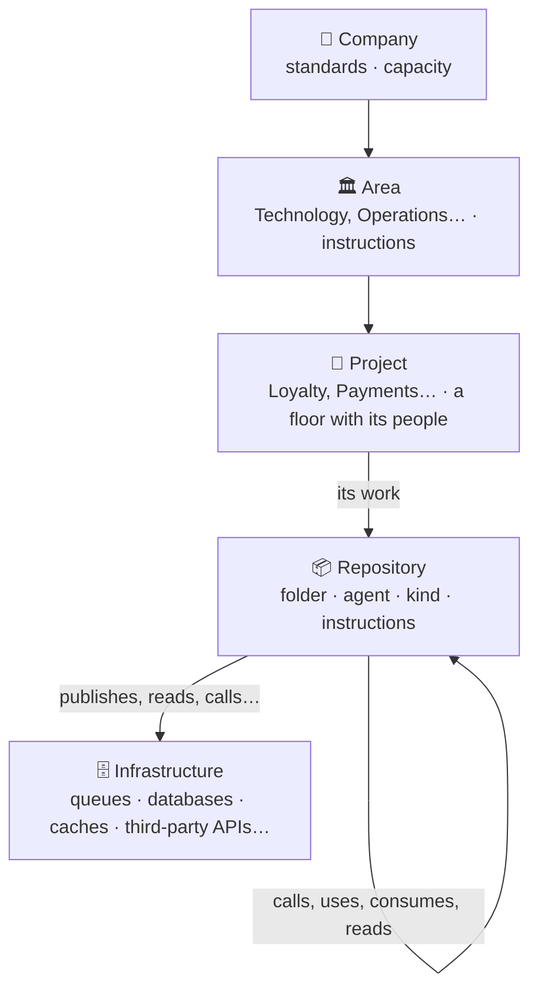
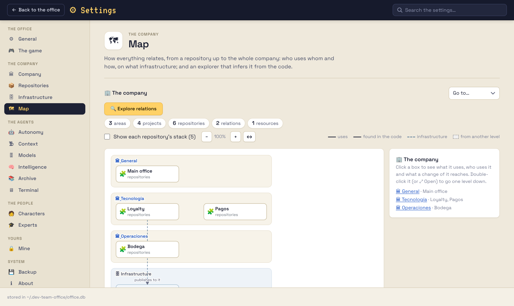

# The company

**English** · [Español](company.es.md)

One running office is a **company**. This guide covers how it is organized and how its pieces relate: areas, projects, repositories, the relations between them and the infrastructure they run on. You edit all of it in the [settings](settings.md) (⚙ › **Company**, **Repositories**, **Infrastructure**) and see it together in ⚙ › **Map**.

## How it fits together



| Piece | What it is | Where you edit it |
|---|---|---|
| **Company** | The whole instance. Its standards (the CTO's) go on top of every brief | ⚙ › Company |
| **Area** | A group of projects (Technology, Operations…). Its instructions go on top of every brief of its projects. There is always a **General** one | ⚙ › Company |
| **Project** | A product or initiative (Loyalty, Payments): drawn as a **floor of the building with its people** (the characters work for the project), with its instructions, autonomy and time zone | ⚙ › Company |
| **Repository** | A folder on your disk plus the agent (CLI) that serves it, and its kind (frontend, BFF, backend…). It belongs to **one** project, which you always choose | ⚙ › Repositories |
| **Relation** | What a repository uses of another: the BFF *calls* the core, a worker *consumes* what another publishes. You say it, or the explorer finds it in the code | ⚙ › Map, or the repository's window |
| **Infrastructure** | What the code runs on or talks to and is not a repository: queues, topics, databases, caches, buckets, other teams' services, third-party APIs, schedulers | ⚙ › Infrastructure |

A repository belongs to one project, but another project may use it (a shared core): on the map it shows up in both, marked ⇄.

## Areas and projects

**⚙ › Company** has everything about the company's shape in one place: its standards and capacity, and its **areas**, each with its **projects**. From a project's card you add a repository to it (it opens the repository's window with the project already chosen), go to its floor, edit its people (⚙ › Characters), open it on the map, or send it a brief.

Each project has:

- **its repositories** (each with its agent) and, through them, its infrastructure;
- **its people**: its characters (their own names, titles, personalities, styles and colors) — the team of the project;
- **its instructions**: how to work there (conventions, what is never done, who to ask). They go on top of every brief, pipeline, directive and question to its repositories, like a ChatGPT or Claude project's;
- **its autonomy**: guided (the analyst reviews each brief and the agent asks you when in doubt), balanced (it reviews, then the agent works to the end) or autonomous (no review); otherwise the company's (⚙ › Autonomy);
- **its time zone** (optional: otherwise the company's), and with it its time, its lunch, its day and night, its season and **its weather**;
- **its activity**: each agent event goes to its project — the one the agent itself states, its session's, its herdr pane's, or the one of the registered repository whose path contains its folder; otherwise, the main one.

**The company has its standards** (the CTO's): what every repository follows (conventions, security, how to document). They go first, then the area's, the project's and the repository's instructions. A brief starts like this (the office takes this header out of the whiteboard's title):

```
📁 Work only inside ~/loyalty-core: …
📋 The company’s standards (the CTO’s):
│ Conventional commits. Every endpoint documented in OpenAPI.
📋 Instructions of the area «Technology»:
│ Every change with its test.
📋 Instructions of the project «Loyalty»:
│ Points never go below zero.
🧩 Artifact loyalty-core (backend / core) of the project Loyalty · used by loyalty-bff
📋 Instructions of the repository «loyalty-core»:
│ pnpm, not npm. Run pnpm test before finishing.

Add a points expiry endpoint
```

The interfaces show **one project's floor at a time**: the one you pick in the selector at the **top left** (web and terminal; also with `o`). The terminal log shows the activity of all of them. The CLI still calls projects `departments` (`dev-team-office departments add`), and the API `offices`.

**Before this version** a company had departments and "systems" (products grouping repositories). When the office opens a database from before, it turns each system into a project of its own (in an area named after its department when the department had several), its parts into relations between repositories, and nothing is lost.

## Repositories: each one with its agent (its harness engineering)

A **repository** is a full path plus the agent (CLI) that serves it (Claude Code, OpenCode or Pi), its kind (detected from its folder, or the one you say) and **the project it belongs to, which you always choose** (it never lands in one by itself). It is registered in **⚙ › Repositories** — one light row each, grouped by area and project; its details open in its own window — or with `dev-team-office agents add`, and saved in the office's SQLite database. What that path brings belongs to the agent: its orchestrator, its subagents, its commands, its pipelines. The office **detects** it and, when sending it a prompt, starts **that** pipeline:

| What the path brings | Pipelines it offers | How it starts |
|---|---|---|
| [Errementari](https://github.com/fmunoztorrent/errementari) (`.errementari.json`) | `/task` (classifies by itself), feature, bugfix, chore, debug | `/task <prompt>` (`/task bug: …`, `/task chore: …`): the `pipeline` agent runs it through spec → architect → qa → backend/frontend → qa → close |
| Claude Code commands (`.claude/commands/*.md`) | `/<command>` | `claude -p "/<command> <prompt>"` |
| OpenCode commands (`opencode.json`, `.opencode/command/`) | `/<command>` | `opencode run --command <command> "<prompt>"` |
| Pi prompts (`.pi/prompts`, `~/.pi/agent/prompts`, e.g. gentle-pi's) | `/<prompt>` | `pi -p "/<prompt> <prompt>"` |
| Dev Team Office pipelines (`.devteam/pipelines`) | `Pipeline · <name>` | An open session runs them, inside itself ([docs/pipelines.md](pipelines.md)) |
| Any path | Direct prompt | The prompt as is, for the harness's default agent |

**Where the prompt goes:**

- **A session open in that path.**
  - Pi and OpenCode get it instantly: Pi expands the `/command` and OpenCode runs it with `session.command`.
  - Claude Code gets it in its `Stop` hook, with the command expanded.
- **A new session.** Inside herdr, the agent opens in a new pane and gets the prompt there. Outside herdr, the office opens the agent's CLI in its path, without a shell and with the prompt as a single argument. The agent's hooks and plugins report everything to the office.

**Which character plays each subagent:** the one from its `role:` (in its file's frontmatter, or `role = "…"` in Codex's TOML); if it does not declare one, the one from its name (`qa`, `architect`, `sdd-apply`…) and, failing that, the one its description suggests ("Runs the e2e tests" → QA). Project ones win over global ones (`~/.claude/agents`, `~/.pi/agent/agents`…), and every session working in that folder learns it by itself, even if its agent does not say. `join` (or `detect_project`) shows the team and which ones do not match any role.

When the orchestrator delegates, the character that moves is that subagent's:

- **Errementari:** spec → analyst, architect → Tech Lead, qa → QA, backend → backend, pipeline → manager.
- **gentle-pi:** `subagent_run`, with sdd-* and review-*.

## Relations between repositories

What a repository uses of another (the BFF **calls** the core's API, a worker **consumes** what another publishes, a front **uses** a library, a job **reads** another's data) is a **relation**. You say it on the map (🔗 Relate, then click the other box), in the repository's window (*What it uses of other repositories*) or with `POST /v1/relations`. A relation inside a project cannot close a circle.

**🔍 Explore relations** (on the map, and in the review when a repository has none) reads the registered repositories' folders and infers them **without a model** — code, not tokens:

- a repository that calls `localhost:<port>` (or a service name of a `docker-compose`) of another that listens there;
- an environment variable named after another repository (`LOYALTY_CORE_URL`);
- a dependency on another repository's package (`"@acme/core"`);
- `depends_on` in a `docker-compose`;
- one that publishes to a queue or topic another consumes.

What it finds is drawn **dashed**, with its evidence (`src/index.js:1 const CORE = process.env.LOYALTY_CORE_URL…`): confirm it (✓) and it becomes yours, or remove it. One you said is never replaced by one found.

**A brief to a project** (🧩 in the whiteboard's list, ✉ Brief on its card, or choosing it on the executive floor) **goes in order**: first what others use (core → BFF → web). Each repository goes when the ones it uses are done, carries **their handoff** (what they left with the MCP tool `handoff`, or the end of their answer) and may read their folders without changing them. If one of them fails, the ones that use it do not go.

**The impact of a directive follows the relations:** changing the core brings in the BFF and the front that use it, and naming the project brings in all its repositories. And **the kind decides who does the code no rule claims:** a frontend repo's `src/lib/money.ts` is the frontend's, an infrastructure repo's, DevOps's.

## Infrastructure

Queues, topics, databases, caches, storage buckets, other teams' services, third-party APIs, schedulers and repositories the office does not have. The office knows them in two ways:

- **Detected** from each repository's folder: its dependencies (`pg`, `kafkajs`, `stripe`…), its `docker-compose` services and the resources its Terraform names (`aws_sqs_queue "refunds"`). A technology on its own (PostgreSQL, Kafka) is the repository's **stack**; a resource with a name is offered to be declared.
- **Declared** in ⚙ › Infrastructure (or by an agent, with the MCP tool `declare_resource`): its kind, its name, what it runs on (SQS, PostgreSQL, Stripe…), where it lives (an account, a cluster, a URL), notes, whether it exists or is still **to be created**, and **who uses it and how**: each repository with its verb (uses, publishes, consumes, reads, writes, calls, schedules, owns).

**What it is for, where and how.** A detected technology says how each repository uses it, read from its code: **what for** (sessions, a job queue, pub/sub, rate limiting, a cache, tables…), **where** it is configured (`src/server.js:2 new Redis(process.env.REDIS_URL)`) and **with which library** (`package.json: ioredis`), each with its file and line. Click it in ⚙ › Infrastructure, or its box on the map (`GET /v1/resources/explain?repo=&tech=`).

On each resource's card you link or unlink a repository in place; **Edit** opens the whole form. An order that names a resource reaches the repositories that use it (see [sizing an order](work.md#sizing-an-order-its-tree-its-graph-and-what-is-not-on-the-map)).

## The architecture map

⚙ › **Map** draws all of the above as one diagram you walk level by level:



| Level | What it shows |
|---|---|
| **The company** | A lane per area with its projects, and which project uses which (through their repositories) |
| **An area** | Its projects with their repositories, and what they use of other areas |
| **A project** | Its repositories with their turn (the order a change goes in), the ones of other projects they use (⇄), and their infrastructure |
| **A repository** | The repositories it uses and the ones that use it, with how, and its infrastructure (and its stack, if you ask) |

- **Solid arrows** are relations you said (labeled with how: *calls*, *uses*, *consumes*, *reads*); **dashed** ones were found by the explorer, or go to the infrastructure (*publishes*, *reads*…).
- **Click a box** to see what it uses, who uses it, **what a change of it reaches** (near and far), its infrastructure, its project and its area; everything else fades. **Double-click** it (or ⤢ Open) to go one level down; the breadcrumbs and **Go to…** take you anywhere.
- **🔗 Relate** (on a repository's panel) and a click on the other box says what it uses; **🔍 Explore relations** infers them from the code; on a found one, **✓** confirms it.
- On a resource's panel, **how each repository uses it**: what for, where and with which library, from its code.
- From the panel, **Edit** opens that thing's form (an area, a project, a repository, a resource) and ✉ **Brief** sends work to a repository or a project.

Under the diagram, the **review** lists what deserves a look, the serious ones first:

| Finding | Why it matters |
|---|---|
| A queue or topic that something publishes to and nothing consumes (or the other way round) | Messages pile up, or a consumer waits forever |
| A declared resource nobody is linked to | The map cannot tell who an order about it reaches |
| A repository whose folder is gone | Its briefs cannot run |
| A project whose repositories use each other in a circle | Its brief has no order to go in |
| A project with several repositories and no relation between them | Nothing says how a change goes: 🔍 explore them |
| A relation found in the code and not confirmed | It may be right or not: confirm it or remove it |
| A repository used by other projects, a resource still to be created, one found in a repository and not declared, a project without repositories | Notes, to keep the map honest |

Agents read the same map with the MCP tool [`get_architecture`](mcp.md), you in a terminal with `dev-team-office architecture` (an outline in your language; `--json`, the whole graph), and other programs with [`GET /v1/architecture`](api.md#the-architecture).
