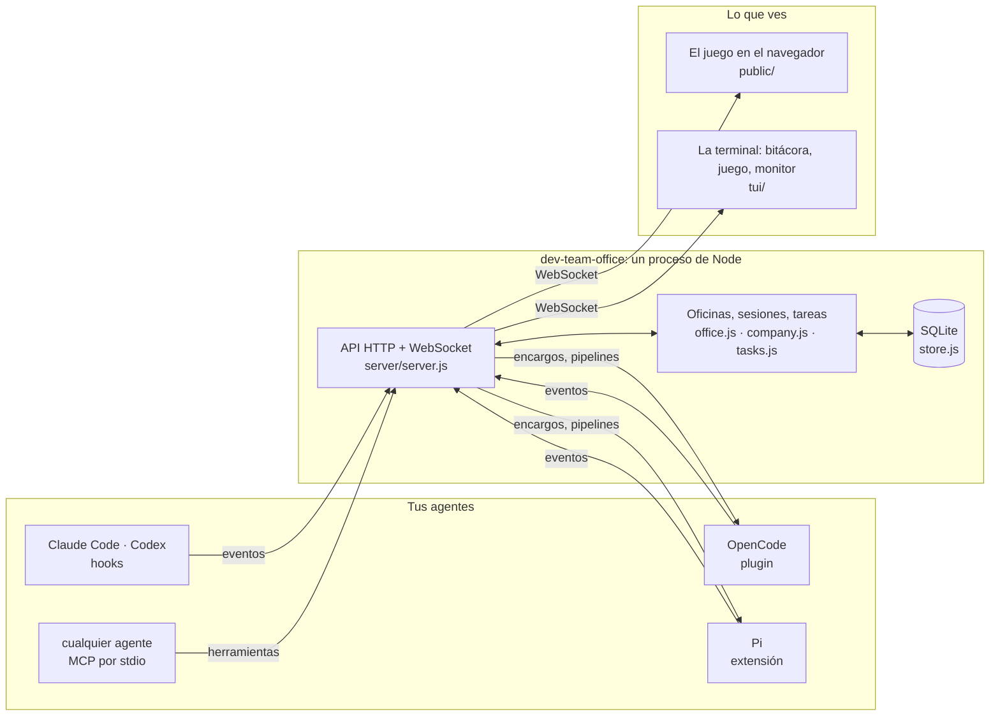

# Cómo está hecha

[English](internals.md) · **Español**

Un mapa del código para quien contribuye: las piezas, cómo viaja un evento por ellas y dónde vive cada cosa. Las reglas para trabajar en él están en [CONTRIBUTING](../CONTRIBUTING.es.md) y en [las convenciones](conventions.es.md); los agentes que trabajan en este repositorio tienen las suyas en [AGENTS.md](../AGENTS.md).

## Las piezas



1. **Un agente hace algo** (usa una herramienta, lanza un subagente, termina su turno). Su integración (`integrations/`) le manda el evento a la oficina por el socket Unix o por HTTP, con tope de tiempo y nunca con un error de vuelta al agente.
2. **El servidor lo entiende:** `server/adapters.js` convierte el payload de cada agente en un evento genérico; `server/company.js` decide de qué departamento es, `server/roles.js` qué personaje lo hace y `server/humanize.js` cómo decirlo en palabras; `server/office.js` actualiza el estado de esa oficina.
3. **Todos los clientes lo reciben** por WebSocket. El navegador y la terminal comparten la simulación (`public/sim.js`), que convierte los eventos en personajes que caminan, escriben y conversan. Lo que se dibuja en cada cuadro es una **escena** de datos planos (`public/scene.js`) que cualquier renderer puede dibujar ([rendering.es.md](rendering.es.md)).
4. **El trabajo va al revés:** un encargo, una directiva o el paso de un loop se convierte en una tarea (`server/tasks.js`) que llega a una sesión abierta (por WebSocket a Pi y OpenCode, en el hook `Stop` a Claude Code) o a una nueva (un pane de herdr, o la CLI del agente en segundo plano).

Todo se guarda en un solo archivo SQLite (`node:sqlite`) y no hay **ninguna dependencia en tiempo de ejecución**: el servidor WebSocket es propio y el cliente es el `WebSocket` global de Node.

## El mapa del código

```
bin/dev-team-office.js  el ejecutable: open (la bitácora + el juego; dentro de herdr, el monitor), monitor, game, serve, start, stop, restart, watch, status, join, follow, demo, send, task, agents, offices, config, pane, btw, mcp, setup, doctor, uninstall, update
bin/setup.js            conecta cada agente (hooks, MCP, skills, lanzador), doctor y uninstall
bin/install.js          copia los archivos de cada integración
install.sh              el instalador de una línea (curl … | sh)
server/mcp.js           el servidor MCP (stdio)
server/asks.js          btw: preguntas al margen al agente de turno
server/directives.js    la dirección: una orden para los proyectos de varias oficinas, y cómo va cada parte
server/archive.js       el archivo: lo que sabe la empresa, y la instalación de sus skills y conectores en un proyecto
server/standup.js       la daily: lo que cuenta cada personaje desde la bitácora real, y su acta
server/components.js    el mapa de la empresa (departamentos → proyectos → componentes) y el impacto de un pedido en él
server/architecture.js  todo el mapa como un grafo (departamentos, proyectos, repositorios, componentes, infraestructura) y su revisión
server/settings-io.js   tus ajustes como archivo JSON: exportar e importar
server/compact.js       la autocompactación: pasado tu tope, se le pide al agente que compacte (a su manera)
server/mine.js          lo tuyo: skills privadas (en tus carpetas personales) y tus herramientas (las corre el MCP)
server/loops.js         el loop de un proyecto: pasos con criterios de éxito, uno tras otro, cada cierto intervalo
server/experts.js       los expertos (SME): quién sabe de cada skill, y qué skill usa una herramienta del agente
server/e2e.js           las pruebas e2e, miradas: lo que cuenta el reporter de Playwright, la traza de cada prueba hecha cuadros y acciones
server/zip.js           un lector de ZIP chico (una traza de Playwright)
server/resources.js     la infraestructura: lo que la carpeta de cada repo dice que usa, lo que un pedido nombra de ella y lo que está en el mapa
server/intelligence.js  el modelo en que se apoya la oficina (uno de tus agentes, la API de Claude, una API compatible con OpenAI u Ollama): el impacto de un pedido
server/ws.js            WebSocket sin dependencias (RFC 6455)
server/server.js        API HTTP + WebSocket en TCP y socket Unix
server/adapters.js      payload nativo → formato genérico
server/office.js        estado: sesiones, todos, subagentes, turnos, bitácora
server/roles.js         qué personaje representa cada herramienta/archivo/comando
server/tasks.js         tareas hacia los agentes: registro, cola, entrega y sesiones nuevas de un agente registrado
server/pipeline.js      pipelines: relay entre la pizarra y la sesión de agente que los ejecuta
server/store.js         la base SQLite: oficinas, repositorios registrados, ajustes (idioma, zona, herdr…), apariencia e historial
server/company.js       la empresa: las oficinas y a cuál va cada evento (por oficina, sesión, pane o ruta)
server/herdr.js         herdr: los agentes y sus actividades en panes (por su CLI), y lo que pasa con esos panes
server/subpanes.js      herdr: un pane por subagente (abre `dev-team-office follow` y lo cierra cuando termina)
server/registry.js      los agentes (registrados + sesiones abiertas), lo que trae su harness y a dónde va un prompt
server/demo.js          sesiones simuladas (Claude Code y flujo TDD de Pi)
server/weather.js       el clima de afuera (Open-Meteo), para la pared de vidrio
public/sim.js           la simulación (personajes, rutas, reacciones, vida de la oficina); la comparten terminal y navegador
public/sky.js           lo que se ve por el vidrio: sol, luna, estaciones, clima y la ciudad (terminal y navegador)
public/clock.js         la hora de la oficina en su zona horaria (ZonedDate), y el país y la ciudad de cada zona
public/zones.js         zona horaria → país y coordenadas (generado desde zone.tab por scripts/gen-zones.mjs)
public/i18n.js          los idiomas del juego (inglés y español); los textos están en public/locales/
public/targets.js       a quién se le puede mandar una tarea (terminal y navegador)
public/brief.js         el diálogo de la pizarra (terminal y navegador)
public/settings-ui.js   ⚙ Ajustes en la web: un área propia (#settings/<sección>), sus secciones en settings-sections.js
public/architecture.js  la arquitectura como dibujo, sin el DOM: lo que muestra cada nivel (empresa, departamento, proyecto, repositorio) y su ubicación
public/architecture-ui.js  ⚙ › Mapa: el diagrama, el panel del nodo elegido y la revisión
public/sprite.js        el retrato de un personaje (ficha y ajustes)
tui/settings.js         ⚙ Ajustes en la terminal
tui/console.js          la bitácora de la terminal donde se lanza la oficina (g juego · o navegador · q salir)
tui/follow.js           el pane de un subagente dentro de herdr: lo que va haciendo, en vivo
tui/monitor.js          el monitor de actividad (dentro de herdr): cifras, cada agente y sus subagentes, el equipo y la bitácora
examples/tienda/        proyecto de ejemplo con equipo, pipelines y agentes
tui/                    la oficina en la terminal: framebuffer de medios bloques, vista, teclado y ratón
public/game.js          la oficina en canvas, para el navegador (vidrio, luces, noche, efectos), en vista frontal o cenital
public/scene.js         la escena: lo que hay en pantalla en cada cuadro, como datos planos (la capa entre el juego y sus renderers)
public/themes.js        los temas gráficos: el elenco anime (todas mujeres), sus peinados y su ropa
public/anime.js         la gente del tema anime, dibujada con trazos vectoriales (las vistas del juego y los retratos)
public/renderers.js     el registro de renderers (otro, uno en 3D, dibuja la misma escena); renderers/plan.js, el de referencia
public/loops-ui.js      el diálogo de los loops
public/e2e-ui.js        la mini pantalla de las pruebas e2e sobre el juego y el reproductor expandido
public/impact.js        el impacto de un pedido como dibujo, sin el DOM: el árbol de sus repos y el grafo de todo lo que toca, ya ubicados
public/impact-ui.js     el árbol (con sus burbujas), el diálogo del grafo y las preguntas sobre lo que no está en el mapa
public/floors.js        los dos pisos compartidos en canvas (la dirección y el archivo): sus escenas y su gente
public/compact.js       el tope de la autocompactación en tokens (lo comparten el servidor y la barra de contexto)
public/floors-ui.js     sus diálogos: las directivas y el archivo
public/iso.js           la cámara isométrica de la vista cenital (piso, paredes y sprites con transformaciones afines)
integrations/common/    la librería del lado del agente: proyecto, pipelines, gates (la usan todas)
integrations/playwright/ el reporter de Playwright de la oficina (sus pruebas e2e, en vivo)
integrations/           Claude Code (hook), Codex (hook), OpenCode (plugin), Pi (extensión)
skills/                 los skills (cualquier harness): eventos por rol y configurar un harness
.claude-plugin/         el plugin y el marketplace de Claude Code
teams/                  team packs instalables (un subagente por rol)
docs/                   instalación, uso, convenciones, API, MCP, eventos por rol, pipelines, el dibujo (la escena) y cómo conectar un harness
test/                   node --test (incluye un agente de mentira: test/fixtures/fake-agent.mjs)
```

Para cambiar quién hace qué, edita las reglas de [`server/roles.js`](../server/roles.js).
