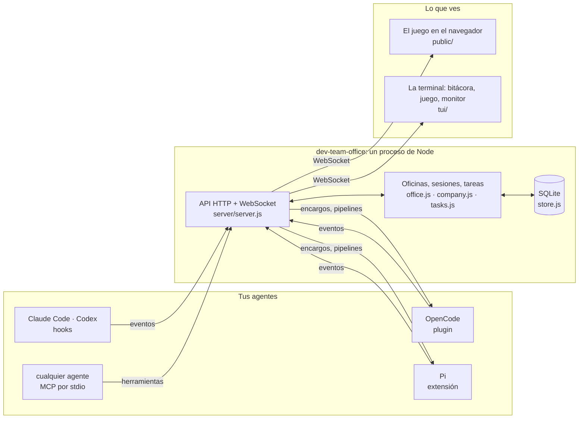

# Cómo está hecha

[English](internals.md) · **Español**

Un mapa del código para quien contribuye: las piezas, cómo viaja un evento por ellas y dónde vive cada cosa. Las reglas para trabajar en él están en [CONTRIBUTING](../CONTRIBUTING.es.md) y en [las convenciones](conventions.es.md); los agentes que trabajan en este repositorio tienen las suyas en [AGENTS.md](../AGENTS.md).

## Las piezas



1. **Un agente hace algo** (usa una herramienta, lanza un subagente, termina su turno). Su integración (`integrations/`) le manda el evento a la oficina por el socket Unix o por HTTP, con tope de tiempo y nunca con un error de vuelta al agente.
2. **El servidor lo entiende:** `server/adapters.js` convierte el payload de cada agente en un evento genérico; `server/company.js` decide de qué departamento es, `server/roles.js` qué personaje lo hace y `server/humanize.js` cómo decirlo en palabras; `server/office.js` actualiza el estado de esa oficina.
3. **Todos los clientes lo reciben** por WebSocket. El navegador y la terminal comparten la simulación (`public/sim.js`), que convierte los eventos en personajes que caminan, escriben y conversan. Lo que se dibuja en cada cuadro es una **escena** de datos planos (`public/scene.js`) que cualquier renderer puede dibujar ([rendering.es.md](rendering.es.md)).
4. **El trabajo va al revés:** un encargo, una directiva o el paso de un loop se convierte en una tarea (`server/tasks.js`) que llega a una sesión abierta (por WebSocket a Pi y OpenCode, en el hook `Stop` a Claude Code) o a una nueva (un pane de herdr, o la CLI del agente en segundo plano).

Todo se guarda en un solo archivo SQLite (`node:sqlite`) y no hay **ninguna dependencia en tiempo de ejecución**: el servidor WebSocket es propio y el cliente es el `WebSocket` global de Node.

## Primero el código, los tokens al final

La oficina decide con código todo lo que el código puede decidir, y al modelo le deja sólo la redacción, nunca los hechos. Así es barata, rápida y da lo mismo cada vez:

| Qué | Cómo, sin modelo |
|---|---|
| Qué personaje hace cada herramienta, archivo o comando | Reglas (`server/roles.js`), y el tipo del repositorio (`detectKind`, de su carpeta) |
| Qué está haciendo cada uno, en palabras | `server/humanize.js` («Corriendo los tests», nunca el comando) |
| Cómo se relacionan los repositorios | `server/explore.js` lee sus carpetas: puertos y URLs, variables de entorno, paquetes, `docker-compose`, colas, con el archivo y la línea que lo dicen |
| Para qué usa un repositorio una tecnología | `explainInfra`: su librería, dónde se configura y para qué (sesiones, una cola, limitar el tráfico…) |
| A quién llega un pedido | El mapa de impacto (`server/components.js`): lo que nombra, lo que usa eso, lo que no está en el mapa |
| De qué repositorio le hablas a alguien, y adónde va una orden al manager | `server/people.js`: nombres y proyectos en el texto |
| Lo último que hizo alguien | `server/narrator.js` convierte la bitácora en hechos; un modelo rápido (opcional) sólo redacta la frase |
| Los aprendizajes de la retro | `server/retro.js` los saca de lo que dijo la tarea |
| La daily | `server/standup.js`, de la bitácora real |

Al modelo se le pregunta sólo donde ayuda el criterio (el impacto de un pedido en `server/intelligence.js`, la revisión de la analista, una pregunta al margen, la frase del narrador), siempre es opcional, y lo que dice se contrasta con los mismos hechos.

## El mapa del código

```
La línea de comandos y la instalación
  bin/dev-team-office.js   el ejecutable: open (la bitácora + el juego; dentro de herdr, el monitor), monitor, game, serve, start,
                           stop, restart, watch, status, join, follow, pane, demo, send, task(s), prompt, agents, offices,
                           character, config, settings, architecture, daily, btw, e2e, team, mcp, setup, doctor, update, uninstall
  bin/setup.js             conecta cada agente (hooks, MCP, skills, lanzador), doctor y uninstall
  bin/install.js           copia los archivos de cada integración
  bin/skills.js            las skills propias de la oficina, instaladas en la carpeta de cada agente con su marca de versión
  bin/team.js              los packs de equipo, en el formato de cada harness, y el equipo que completa `join`
  install.sh               el instalador de una línea (curl … | sh)
  scripts/                 la demo y el envío de eventos, el generador de la tabla de zonas, el flujo real aislado
                           (dev-session.sh) y la prueba de instalación de un usuario nuevo (install-check.mjs)

El servidor: un proceso de Node
  server/index.js          `npm start`: la oficina sin la interfaz de la terminal
  server/server.js         la API HTTP + WebSocket por TCP y por un socket Unix, y el cableado de todo
  server/ws.js             un WebSocket sin dependencias (RFC 6455)
  server/lifecycle.js      desde fuera: si hay una corriendo (y qué versión), detenerla, iniciarla en segundo plano
  server/store.js          la base SQLite: departamentos, repositorios, ajustes (prefs), apariencia, historial,
                           directivas, el archivo, proyectos, loops, expertos, infraestructura
  server/paths.js          carpetas comparadas por su ruta real (/tmp es /private/tmp en macOS)
  server/settings-io.js    tus ajustes como archivo JSON: exportar e importar

Los eventos entran: de un agente a un personaje
  server/adapters.js       el payload de cada agente → un evento genérico
  server/company.js        los departamentos, y a cuál va cada evento (por oficina, sesión, pane o carpeta)
  server/office.js         el estado de una oficina: sesiones, todos, subagentes (subId), turnos, la pizarra, la bitácora
  server/roles.js          qué personaje hace cada herramienta, archivo o comando
  server/humanize.js       lo que hacen, dicho en palabras, y el badge sobre su cabeza
  server/experts.js        los expertos: qué skill usa una herramienta del agente
  server/compact.js        la autocompactación: pasado tu tope, se le pide al agente que compacte (a su manera)
  server/services.js       los servicios que un agente deja corriendo (un dev server, un watcher): si siguen vivos, y sus logs
  server/prompts.js        lo que un agente te pregunta en su pantalla (dentro de herdr), y las teclas que lo contestan
  server/e2e.js            las pruebas e2e, miradas: los eventos del reporter de Playwright, la traza de cada prueba como cuadros
  server/zip.js            un lector de ZIP chico (una traza de Playwright)
  server/weather.js        el clima afuera (Open-Meteo), para el ventanal

El trabajo sale: de ti a un agente
  server/tasks.js          los encargos: la cola, la entrega a una sesión abierta, o una nueva (un pane de herdr, o la CLI)
  server/registry.js       los agentes (registrados + sesiones abiertas), lo que trae su harness, a dónde va un prompt
  server/pipeline.js       los pipelines: el relevo entre la pizarra y la sesión que los corre
  server/clarify.js        la revisión de la analista antes de que un encargo pase a trabajo, y tus respuestas
  server/guides.js         los estándares de la empresa y las indicaciones de cada departamento y repositorio, sobre cada encargo
  server/asks.js           btw: preguntas al margen al agente de turno
  server/directives.js     la dirección: una orden para varios departamentos, primero su impacto, sus partes en orden
  server/loops.js          el loop de un proyecto: pasos con criterios de éxito, enviados uno tras otro
  server/standup.js        la daily: lo que cuenta cada personaje desde la bitácora real, y su acta
  server/herdr.js          herdr: los agentes y sus actividades en panes, con su CLI
  server/subpanes.js       herdr: un pane por subagente (`dev-team-office follow`)
  server/mcp.js            el servidor MCP (stdio): las herramientas que llaman los agentes, y el prompt `join`
  server/mine.js           lo tuyo: skills privadas en tus carpetas personales, y tus herramientas (`my_<nombre>`)

El mapa de la empresa
  server/components.js     departamentos → repositorios → componentes, y el impacto de un pedido en ellos
  server/systems.js        los proyectos: sus artefactos, qué usa cada uno y el orden en que va un cambio
  server/resources.js      la infraestructura: lo que los archivos de cada repositorio dicen que usa, y lo que nombra un pedido
  server/architecture.js   todo como un grafo, su revisión, y su esquema para un agente o la CLI
  server/intelligence.js   el modelo en que se apoya la oficina (uno de tus agentes, la API de Claude, compatible con OpenAI, Ollama)

El archivo
  server/archive.js        notas, decisiones, documentos, skills y conectores; instalar skills y conectores en un proyecto
  server/rag.js            el archivo como RAG: búsqueda por palabras (FTS5) y por significado, el glosario y los vacíos
  server/chunks.js         un documento cortado en fragmentos
  server/ingest.js         el texto legible de un documento (Markdown, HTML…; PDF y Word con pdftotext o pandoc, si la máquina los tiene)

El navegador (public/)
  public/main.js           la página: la conexión, el HUD, los diálogos y las teclas
  public/sim.js            la simulación (personajes, rutas, reacciones, vida de la oficina); la comparte con la terminal
  public/scene.js          lo que hay en pantalla cada cuadro, como datos planos: la capa entre el juego y sus renderers
  public/renderers.js      el registro de renderers; renderers/plan.js es el de referencia
  public/game.js · iso.js  la oficina en canvas, en vista frontal y en la cenital isométrica
  public/themes.js · anime.js  los temas gráficos, y el elenco anime dibujado con trazos vectoriales
  public/sprite.js         el retrato de un personaje (ficha y ajustes)
  public/sky.js · clock.js · zones.js  lo que se ve por el ventanal, la hora de la oficina, el país y la ciudad de cada zona
  public/floors.js · floors-ui.js  la dirección y el archivo: sus escenas y sus diálogos
  public/brief.js · targets.js · board-ui.js  el diálogo del encargo, a quién puede ir un encargo, y los post-its de la pizarra
  public/impact.js · impact-ui.js  el impacto de un pedido como dibujos (árbol y grafo) y las preguntas por lo que no está en el mapa
  public/architecture.js · architecture-ui.js  la arquitectura como dibujo (cada nivel, su ubicación) y ⚙ › Mapa
  public/settings-ui.js · settings-sections.js  ⚙ Ajustes: un área propia (#settings/<sección>) y sus secciones
  public/loops-ui.js · e2e-ui.js · services-ui.js · prompts-ui.js  los loops, la pantalla e2e, los servicios y las preguntas de los agentes
  public/character.js · models.js · compact.js  un personaje como JSON, los perfiles de modelos, el tope de la compactación
  public/markdown.js       un renderer de Markdown chico y seguro (el archivo)
  public/i18n.js · locales/  los idiomas, y cada texto de la interfaz (en.js, es.js)

La terminal (tui/)
  tui/app.js · view.js · screen.js  el juego en la terminal: su ciclo y sus teclas, la escena en medios bloques, el framebuffer
  tui/feeds.js             de dónde saca sus eventos: el servidor en el mismo proceso, u otra oficina (`watch`)
  tui/console.js           la bitácora de la terminal donde parte la oficina
  tui/monitor.js           el monitor de actividad (dentro de herdr)
  tui/follow.js            el pane de un subagente dentro de herdr
  tui/settings.js          ⚙ Ajustes en la terminal (los de todos los días)

Lo que corre junto al agente
  integrations/common/     la librería del lado del agente: proyecto, subagentes, pipelines, gates, la ruta del reporter e2e
  integrations/claude-code/  el hook de Claude Code (y los hooks del plugin)
  integrations/codex/      el hook de Codex
  integrations/opencode/   el plugin de OpenCode
  integrations/pi/         la extensión de Pi (también sus subagentes)
  integrations/playwright/ el reporter de Playwright de la oficina
  skills/                  las skills de la oficina (cualquier harness): trabajar con la oficina, declarar roles, no desviarse
  .claude-plugin/          el plugin de Claude Code y su marketplace
  teams/                   packs de equipo instalables (un subagente por rol)
  examples/tienda/         un proyecto de ejemplo con equipo, pipelines y agentes

docs/                      las guías (índice en docs/README.md), cada una en inglés y en español
test/                      node --test, con agentes y herdr de mentira (test/fixtures)
```

Para cambiar quién hace qué, edita las reglas de [`server/roles.js`](../server/roles.js).
