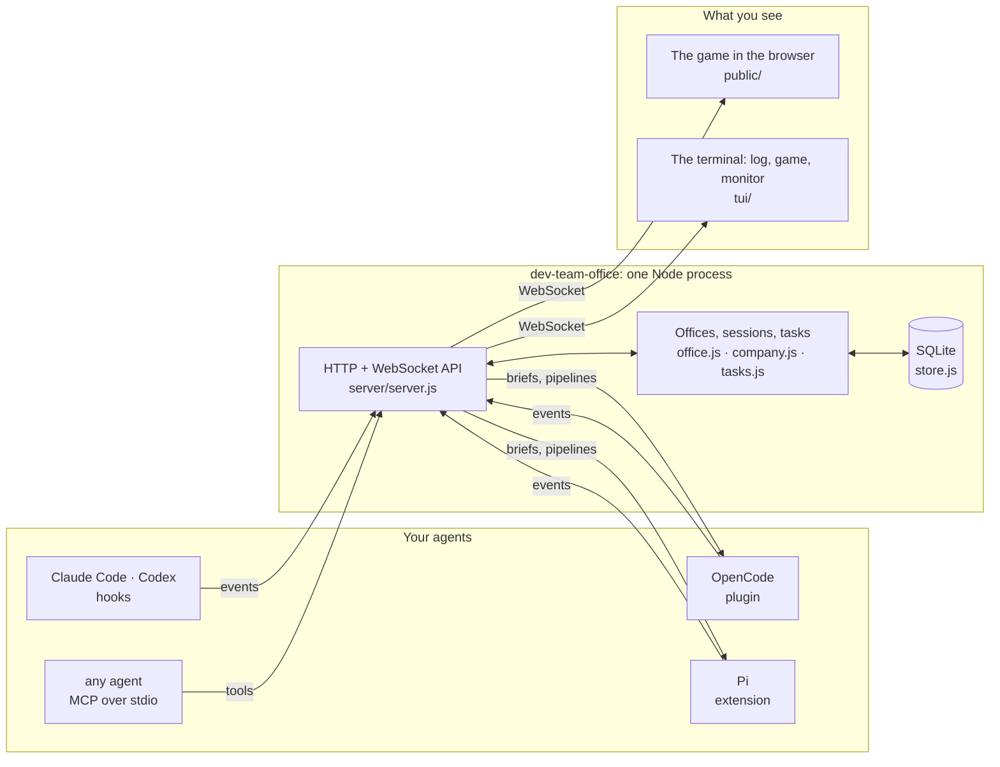

# How it is built

**English** · [Español](internals.es.md)

A map of the code for contributors: the pieces, how an event travels through them, and where each thing lives. The rules for working on it are in [CONTRIBUTING](../CONTRIBUTING.md) and [the conventions](conventions.md); the agents working on this repository have theirs in [AGENTS.md](../AGENTS.md).

## The pieces



1. **An agent does something** (a tool call, a subagent, the end of a turn). Its integration (`integrations/`) sends the event to the office through the Unix socket or over HTTP, with a time limit and never an error back to the agent.
2. **The server makes sense of it:** `server/adapters.js` turns each agent's payload into one generic event; `server/company.js` decides which department it belongs to, `server/roles.js` which character does it and `server/humanize.js` how to say it in words; `server/office.js` updates that office's state.
3. **Every client gets it** over WebSocket. The browser and the terminal share the simulation (`public/sim.js`), which turns events into characters walking, typing and talking. What is drawn each frame is a plain **scene** (`public/scene.js`) that any renderer can draw ([rendering.md](rendering.md)).
4. **Work goes the other way:** a brief, a directive or a loop step becomes a task (`server/tasks.js`) that reaches an open session (over WebSocket for Pi and OpenCode, at the `Stop` hook for Claude Code) or a new one (a herdr pane, or the agent's CLI in the background).

Everything is kept in one SQLite file (`node:sqlite`), and there are **no runtime dependencies**: the WebSocket server is the office's own and the client is Node's global `WebSocket`.

## Code map

```
bin/dev-team-office.js  the executable: open (the log + the game; inside herdr, the monitor), monitor, game, serve, start, stop, restart, watch, status, join, follow, demo, send, task, agents, offices, config, pane, btw, mcp, setup, doctor, uninstall, update
bin/setup.js            connects each agent (hooks, MCP, skills, launcher), doctor and uninstall
bin/install.js          copies each integration's files
bin/team.js             the team packs, in each harness's format, and the team `join` completes
install.sh              the one-line installer (curl … | sh)
server/mcp.js           the MCP server (stdio)
server/asks.js          btw: side questions to the agent on duty
server/directives.js    the executive floor: one order for several offices' projects, and how each part goes
server/archive.js       the archive: the company's knowledge, and installing its skills and connectors in a project
server/standup.js       the daily standup: each character's report from the real log, and its minutes
server/components.js    the company's map (departments → projects → components) and an order's impact on it
server/architecture.js  the whole map as one graph (departments, projects, repositories, components, infrastructure) and its review
server/settings-io.js   your settings as a JSON file: export and import
server/compact.js       auto-compaction: past your limit, the agent is asked to compact (its way)
server/mine.js          yours: private skills (in your personal folders) and your own tools (run through the MCP)
server/loops.js         a project's loop: steps with success criteria, worked through one after the other at an interval
server/experts.js       the subject matter experts: who knows each skill, and which skill an agent's tool uses
server/e2e.js           the e2e tests, watched: what the Playwright reporter tells, each test's trace as frames and actions
server/zip.js           a small ZIP reader (a Playwright trace)
server/resources.js     the infrastructure: what each repo's folder says it uses, what an order names of it, and what is on the map
server/intelligence.js  the model the office leans on (one of your agents, the Claude API, an OpenAI-compatible API or Ollama): an order's impact
server/ws.js            dependency-free WebSocket (RFC 6455)
server/server.js        HTTP + WebSocket API over TCP and a Unix socket
server/adapters.js      native payload → generic format
server/office.js        state: sessions, todos, subagents, turns, log
server/roles.js         which character stands for each tool/file/command
server/tasks.js         tasks for the agents: registration, queue, delivery and new sessions of a registered agent
server/pipeline.js      pipelines: relay between the whiteboard and the agent session that runs them
server/store.js         the SQLite database: offices, registered repositories, settings (language, zone, herdr…), appearance and history
server/company.js       the company: the offices and which one each event goes to (by office, session, pane or path)
server/herdr.js         herdr: the agents and their activities in panes (through its CLI), and what happens to those panes
server/subpanes.js      herdr: one pane per subagent (opens `dev-team-office follow` and closes it when it finishes)
server/registry.js      the agents (registered + open sessions), what their harness brings and where a prompt goes
server/demo.js          simulated sessions (Claude Code and Pi's TDD flow)
server/weather.js       the weather outside (Open-Meteo), for the glass wall
public/sim.js           the simulation (characters, routes, reactions, office life); shared by terminal and browser
public/sky.js           what is seen through the glass: sun, moon, seasons, weather and the city (terminal and browser)
public/clock.js         the office's time in its time zone (ZonedDate), and each zone's country and city
public/zones.js         time zone → country and coordinates (generated from zone.tab by scripts/gen-zones.mjs)
public/i18n.js          the game's languages (English and Spanish); the texts are in public/locales/
public/targets.js       who a task can be sent to (terminal and browser)
public/brief.js         the whiteboard dialog (terminal and browser)
public/settings-ui.js   ⚙ Settings on the web: an area of its own (#settings/<section>), its sections in settings-sections.js
public/architecture.js  the architecture as a picture, without the DOM: what each level shows (company, department, project, repository) and its layout
public/architecture-ui.js  ⚙ › Map: the diagram, the selected node's panel and the review
public/sprite.js        a character's portrait (sheet and settings)
public/game.js          the office on canvas, for the browser (glass, lights, night, effects), in front or top-down view
public/scene.js         the scene: what is on screen each frame, as plain data (the layer between the game and its renderers)
public/themes.js        the graphic themes: the anime cast (all women), its hair styles and outfits
public/anime.js         the anime theme's people, drawn with vector strokes (the game's views and the portraits)
public/renderers.js     the renderers' registry (another one, a 3D one, draws the same scene); renderers/plan.js, the reference
public/loops-ui.js      the loops' dialog
public/e2e-ui.js        the e2e tests' mini screen over the game and the expanded player
public/impact.js        an order's impact as pictures, without the DOM: the tree of its repos and the graph of everything it touches, laid out
public/impact-ui.js     the tree (with its bubbles), the graph's dialog and the questions about what is not on the map
public/floors.js        the two shared floors on canvas (the executive one and the archive): their scenes and people
public/compact.js       the auto-compaction's limit in tokens (shared by the server and the context bar)
public/floors-ui.js     their dialogs: directives and the archive
public/iso.js           the top-down view's isometric camera (floor, walls and sprites with affine transforms)
tui/                    the office in the terminal: half-block framebuffer, view, keyboard and mouse
tui/settings.js         ⚙ Settings in the terminal
tui/console.js          the log of the terminal where the office is launched (g game · o browser · q quit)
tui/follow.js           a subagent's pane inside herdr: what it is doing, live
tui/monitor.js          the activity monitor (inside herdr): figures, each agent and its subagents, the team and the log
examples/tienda/        sample project with a team, pipelines and agents
integrations/common/    the agent-side library: project, pipelines, gates (used by all of them)
integrations/playwright/ the office's Playwright reporter (its e2e tests, live)
integrations/           Claude Code (hook), Codex (hook), OpenCode (plugin), Pi (extension)
skills/                 the skills (any harness): events by role and configuring a harness
.claude-plugin/         the Claude Code plugin and marketplace
teams/                  installable team packs (one subagent per role)
docs/                   installation, usage, conventions, API, MCP, events by role, pipelines, rendering (the scene) and how to connect a harness (English, with .es.md in Spanish)
test/                   node --test (includes a fake agent: test/fixtures/fake-agent.mjs)
```

To change who does what, edit the rules in [`server/roles.js`](../server/roles.js).
