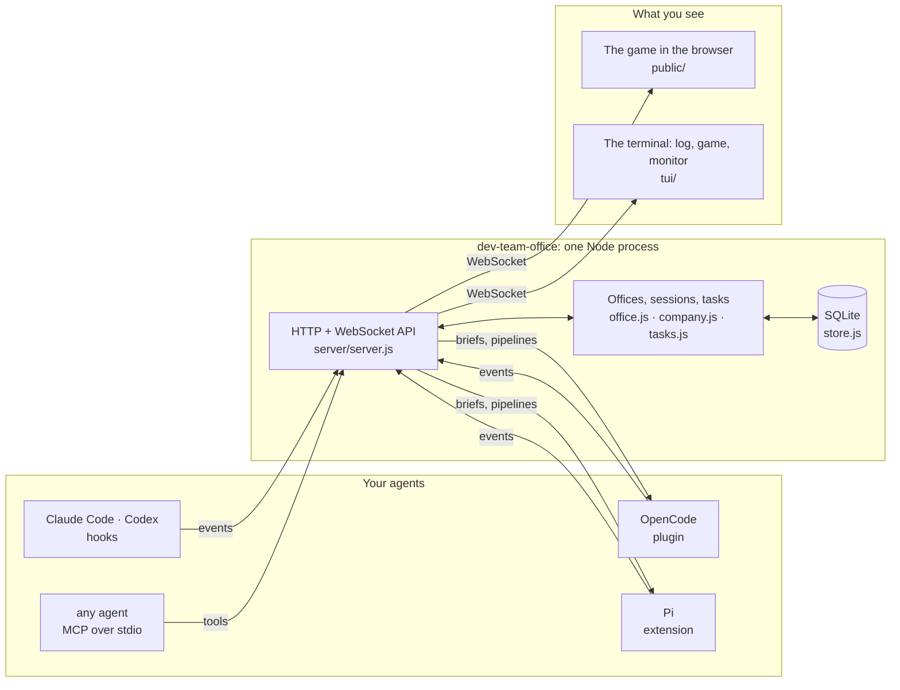

# How it is built

**English** · [Español](internals.es.md)

A map of the code for contributors: the pieces, how an event travels through them, and where each thing lives. The rules for working on it are in [CONTRIBUTING](../CONTRIBUTING.md) and [the conventions](conventions.md); the agents working on this repository have theirs in [AGENTS.md](../AGENTS.md).

## The pieces



1. **An agent does something** (a tool call, a subagent, the end of a turn). Its integration (`integrations/`) sends the event to the office through the Unix socket or over HTTP, with a time limit and never an error back to the agent.
2. **The server makes sense of it:** `server/adapters.js` turns each agent's payload into one generic event; `server/company.js` decides which department it belongs to, `server/roles.js` which character does it and `server/humanize.js` how to say it in words; `server/office.js` updates that office's state.
3. **Every client gets it** over WebSocket. The browser and the terminal share the simulation (`public/sim.js`), which turns events into characters walking, typing and talking. What is drawn each frame is a plain **scene** (`public/scene.js`) that any renderer can draw ([rendering.md](rendering.md)).
4. **Work goes the other way:** a brief, a directive or a loop step becomes a task (`server/tasks.js`) that reaches an open session (over WebSocket for Pi and OpenCode, at the `Stop` hook for Claude Code) or a new one (a herdr pane, or the agent's CLI in the background).

Everything is kept in one SQLite file (`node:sqlite`), and there are **no runtime dependencies**: the WebSocket server is the office's own and the client is Node's global `WebSocket`.

## Code first, tokens last

The office decides with code whatever code can decide, and leaves a model only the wording, never the facts. That keeps it cheap, fast and the same every time:

| What | How, without a model |
|---|---|
| Which character does each tool, file or command | Rules (`server/roles.js`), and the repository's kind (`detectKind`, from its folder) |
| What each one is doing, in words | `server/humanize.js` (“Running the tests”, never the command) |
| How repositories relate | `server/explore.js` reads their folders: ports and URLs, env vars, packages, `docker-compose`, queues — with the file and line that says so |
| What a technology is for in a repository | `explainInfra`: its library, where it is configured, and what for (sessions, a queue, rate limiting…) |
| Who an order reaches | The impact map (`server/components.js`): what it names, what uses that, what is not on the map |
| Which repository you are talking about, and where an order to the manager goes | `server/people.js`: names and projects in the text |
| What someone did lately | `server/narrator.js` turns the log into facts; a fast model (optional) only writes the sentence |
| The retro's learnings | `server/retro.js` picks them from what the task said |
| The daily | `server/standup.js`, from the real log |

A model is asked only where judgment helps (an order's impact in `server/intelligence.js`, the analyst's review, a side question, the narrator's sentence), it is always optional, and what it says is checked against the same facts.

## Code map

```
The command line and the installation
  bin/dev-team-office.js   the executable: open (the log + the game; inside herdr, the monitor), monitor, game, serve, start,
                           stop, restart, watch, status, join, follow, pane, demo, send, task(s), prompt, agents, offices,
                           character, config, settings, architecture, daily, btw, e2e, team, mcp, setup, doctor, update, uninstall
  bin/setup.js             connects each agent (hooks, MCP, skills, launcher), doctor and uninstall
  bin/install.js           copies each integration's files
  bin/skills.js            the office's own skills, installed in each agent's folder with a version mark
  bin/team.js              the team packs, in each harness's format, and the team `join` completes
  install.sh               the one-line installer (curl … | sh)
  scripts/                 the demo and send helpers, the zone table generator, the isolated real flow
                           (dev-session.sh) and a new user's install check (install-check.mjs)

The server: one Node process
  server/index.js          `npm start`: the office without the terminal interface
  server/server.js         the HTTP + WebSocket API over TCP and a Unix socket, and the wiring of everything
  server/ws.js             a dependency-free WebSocket (RFC 6455)
  server/lifecycle.js      from the outside: is one running (which version), stop it, start it in the background
  server/store.js          the SQLite database: departments, repositories, settings (prefs), appearance, history,
                           directives, the archive, projects, loops, experts, infrastructure
  server/paths.js          folders compared by their real path (/tmp is /private/tmp on macOS)
  server/settings-io.js    your settings as a JSON file: export and import

Events in: from an agent to a character
  server/adapters.js       each agent's payload → one generic event
  server/company.js        the departments, and which one each event goes to (by office, session, pane or folder)
  server/office.js         one office's state: sessions, todos, subagents (subId), turns, the whiteboard, the log
  server/roles.js          which character does each tool, file or command
  server/humanize.js       what they do, said in words, and the badge over their head
  server/experts.js        the subject matter experts: which skill an agent's tool uses
  server/compact.js        auto-compaction: past your limit, the agent is asked to compact (its way)
  server/services.js       the services an agent leaves running (a dev server, a watcher): alive or not, and their logs
  server/prompts.js        what an agent asks you on its screen (inside herdr), and the keys that answer it
  server/e2e.js            the e2e tests, watched: the Playwright reporter's events, each test's trace as frames
  server/zip.js            a small ZIP reader (a Playwright trace)
  server/weather.js        the weather outside (Open-Meteo), for the glass wall

Work out: from you to an agent
  server/tasks.js          the briefs: queue, delivery to an open session, or a new one (herdr pane, or the CLI)
  server/registry.js       the agents (registered + open sessions), what their harness brings, where a prompt goes
  server/pipeline.js       pipelines: the relay between the whiteboard and the session that runs them
  server/clarify.js        the analyst's review of a brief before it becomes work, and your answers
  server/guides.js         the company's standards and each department's and repository's instructions, over every brief
  server/asks.js           btw: side questions to the agent on duty
  server/directives.js     the executive floor: one order for several departments, its impact first, its parts in order
  server/loops.js          a project's loop: steps with success criteria, sent one after the other
  server/standup.js        the daily: each character's report from the real log, and its minutes
  server/herdr.js          herdr: the agents and their activities in panes, through its CLI
  server/subpanes.js       herdr: one pane per subagent (`dev-team-office follow`)
  server/mcp.js            the MCP server (stdio): the tools agents call, and the `join` prompt
  server/mine.js           yours: private skills in your personal folders, and your own tools (`my_<name>`)

The company's map
  server/components.js     departments → repositories → components, and an order's impact on them
  server/systems.js        the projects: their artifacts, what each one uses and the order a change goes in
  server/resources.js      the infrastructure: what each repository's files say it uses, and what an order names
  server/architecture.js   everything as one graph, its review, and its outline for an agent or the CLI
  server/intelligence.js   the model the office leans on (one of your agents, the Claude API, OpenAI-compatible, Ollama)

The archive
  server/archive.js        notes, decisions, documents, skills and connectors; installing skills and connectors in a project
  server/rag.js            the archive as a RAG: search by words (FTS5) and by meaning, the glossary and the gaps
  server/chunks.js         a document cut into passages
  server/ingest.js         a document's readable text (Markdown, HTML…; PDF and Word with pdftotext or pandoc, when the machine has them)

The browser (public/)
  public/main.js           the page: the connection, the HUD, the dialogs and the keys
  public/sim.js            the simulation (characters, routes, reactions, office life); shared with the terminal
  public/scene.js          what is on screen each frame, as plain data: the layer between the game and its renderers
  public/renderers.js      the renderers' registry; renderers/plan.js is the reference one
  public/game.js · iso.js  the office on canvas, in front view and in the isometric top-down view
  public/themes.js · anime.js  the graphic themes, and the anime cast drawn with vector strokes
  public/sprite.js         a character's portrait (sheet and settings)
  public/sky.js · clock.js · zones.js  what is seen through the glass, the office's time, each zone's country and city
  public/floors.js · floors-ui.js  the executive floor and the archive: their scenes and their dialogs
  public/brief.js · targets.js · board-ui.js  the brief dialog, who a brief can go to, and the whiteboard's post-its
  public/impact.js · impact-ui.js  an order's impact as pictures (tree and graph) and the questions about what is not on the map
  public/architecture.js · architecture-ui.js  the architecture as a picture (each level, its layout) and ⚙ › Map
  public/settings-ui.js · settings-sections.js  ⚙ Settings: an area of its own (#settings/<section>) and its sections
  public/loops-ui.js · e2e-ui.js · services-ui.js · prompts-ui.js  the loops, the e2e screen, the services and the agents' questions
  public/character.js · models.js · compact.js  a character as JSON, the model profiles, the compaction limit
  public/markdown.js       a small, safe Markdown renderer (the archive)
  public/i18n.js · locales/  the languages, and every text of the interface (en.js, es.js)

The terminal (tui/)
  tui/app.js · view.js · screen.js  the terminal game: its loop and keys, the scene drawn in half blocks, the framebuffer
  tui/feeds.js             where it gets its events: the server in the same process, or another office (`watch`)
  tui/console.js           the log of the terminal where the office starts
  tui/monitor.js           the activity monitor (inside herdr)
  tui/follow.js            a subagent's pane inside herdr
  tui/settings.js          ⚙ Settings in the terminal (the everyday ones)

What runs next to the agent
  integrations/common/     the agent-side library: project, subagents, pipelines, gates, the e2e reporter's path
  integrations/claude-code/  Claude Code's hook (and the plugin's hooks)
  integrations/codex/      Codex's hook
  integrations/opencode/   OpenCode's plugin
  integrations/pi/         Pi's extension (also its subagents)
  integrations/playwright/ the office's Playwright reporter
  skills/                  the office's skills (any harness): working with the office, declaring roles, staying focused
  .claude-plugin/          the Claude Code plugin and its marketplace
  teams/                   installable team packs (one subagent per role)
  examples/tienda/         a sample project with a team, pipelines and agents

docs/                      the guides (index in docs/README.md), each in English and Spanish
test/                      node --test, with fakes for the agents and herdr (test/fixtures)
```

To change who does what, edit the rules in [`server/roles.js`](../server/roles.js).
