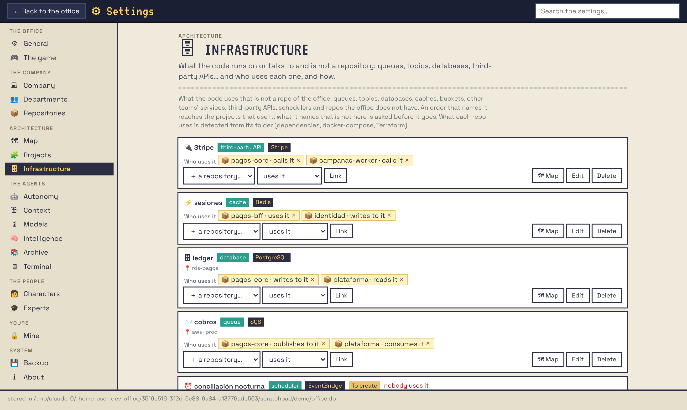

# Ajustes

[English](settings.md) · **Español**

Todo lo que configuras en la oficina vive en un solo lugar: el **área de ajustes**. Se abre con **⚙** (arriba a la derecha del juego) o con `c`; `Esc` o **← Volver a la oficina** te devuelve. Es una página propia, no un diálogo sobre el juego, y tiene dirección: `http://127.0.0.1:4317/#settings/<sección>` abre una sección directo, y el botón atrás del navegador funciona.

- **El menú** de la izquierda agrupa las secciones. En un teléfono se vuelve un selector arriba.
- **El buscador** (arriba a la derecha) encuentra una sección por su nombre, por para qué es o por las palabras de lo que tiene («kafka», «tokens», «herdr»); Enter va a la primera.
- **Los cambios se aplican apenas los haces** y la oficina los usa al tiro. Sólo **Personajes** y **Modelos**, que se editan como borrador, tienen el botón **Guardar** abajo.
- El juego en la terminal tiene sus propios ajustes, más chicos (`c`), sobre los mismos datos.

## Las secciones

| Grupo | Sección | Qué hay |
|---|---|---|
| La oficina | **General** | El idioma (inglés o español: lo cambia todo en vivo, en el navegador, la terminal y la bitácora), la zona horaria de la empresa (escribe una ciudad, una región o un país) y su ciudad (para el clima, el sol y la luna), y si el clima es el real o simulado |
| | **El juego** | La vista (frontal, o cenital isométrica), el estilo de su gente (pixel art, o anime: un equipo de mujeres), la vida de la oficina en la bitácora, y el sonido y la notificación del sistema de este navegador cuando un agente te espera |
| La empresa | **Empresa** | Los estándares de la empresa (los del CTO: van arriba de cada encargo, antes de las indicaciones del departamento y del repositorio) y su capacidad: cuántos encargos de una directiva toma un departamento a la vez |
| | **Departamentos** | Cada departamento con sus indicaciones, su autonomía, su zona horaria y su ciudad, y sus repositorios (＋ uno nuevo, o traer uno que ya existe); 👁 mirarlo, 🗺 verlo en el mapa |
| | **Repositorios** | Los repositorios de todos los departamentos: agregar uno (su ruta completa, el agente que lo atiende y su departamento; el harness que trae se detecta mientras escribes), sus indicaciones, sus componentes (declara uno con su carpeta), ✉ mandarle un prompt. También las sesiones abiertas que nadie registró |
| Arquitectura | **Mapa** | El [mapa de la arquitectura](company.es.md#el-mapa-de-la-arquitectura): todo relacionado, desde un componente hasta la empresa entera, y su revisión |
| | **Proyectos** | Cada producto con sus artefactos (un repositorio, o un componente de uno), sus tipos, lo que usa cada uno y el orden en que va un cambio; su equipo (un departamento, o uno propio) y sus indicaciones. **↻ Proponer tipos y dependencias** los completa |
| | **Infraestructura** | Los recursos declarados con quién usa cada uno y cómo (vincular y desvincular ahí mismo), lo que nombran los repositorios y nadie declaró todavía (**Declarar**), el stack de cada repositorio, y el formulario |
| Los agentes | **Autonomía** | Si la analista revisa cada encargo antes de que pase a trabajo, y si los agentes trabajan hasta el final sin detenerse a preguntar. Cada departamento puede tener su propio nivel |
| | **Contexto** | La autocompactación: encendida o apagada, y el tope (en miles de tokens, o una parte de la ventana; 400k tokens por defecto) |
| | **Modelos** | Los perfiles de modelos: qué modelo usa cada rol, para qué harnesses, y el perfil por defecto |
| | **Inteligencia** | El modelo en que se apoya la oficina para juzgar (hoy, el impacto de un pedido): ninguno, uno de tus agentes (en sólo lectura), la API de Claude, una API compatible con OpenAI u Ollama, y **🧪 Probar**. Las claves van en el entorno, nunca en la base |
| | **Archivo** | Si los fragmentos del archivo van arriba de cada encargo, la búsqueda por significado (embeddings, con Ollama u OpenAI) y el índice (**↻ Indexarlo de nuevo**) |
| | **Terminal** | herdr: abrir el agente en un pane, cada subagente en el suyo, hacia dónde se abren los panes y qué agente se abre al partir |
| La gente | **Personajes** | Cada personaje de la oficina que estás mirando: nombre, cargo, sexo, personalidad, estilo (cómo te contesta), colores, pelo largo, barba y lentes. **⬇ Exportar / ⬆ Importar** un personaje como archivo JSON |
| | **Expertos** | Los expertos (SME): cada uno asociado a una skill, con de qué sabe, su aspecto y sus acciones rápidas |
| Lo tuyo | **Mío** | Tus skills privadas (instaladas en tu carpeta personal de cada agente, nunca en un repositorio) y tus herramientas (scripts que tus agentes ven como la herramienta MCP `my_<nombre>`). Los agentes no pueden crearlas: sólo tú |
| Sistema | **Respaldo** | **⬇ Exportar / ⬆ Importar** tus ajustes como archivo JSON (también `dev-team-office settings export\|import`), y dónde está la base |
| | **Acerca de** | La versión que está corriendo, su dirección, dónde guarda sus datos, la documentación y las teclas del juego |

**Qué lleva un archivo de ajustes:** los ajustes generales, los departamentos con sus indicaciones, autonomía y personajes, los repositorios con sus indicaciones y componentes, los proyectos, la infraestructura, tus skills y herramientas, y los expertos. No el historial ni el archivo. Importar mezcla pieza por pieza: lo que trae el archivo reemplaza lo de aquí, lo demás se queda, y lo que no se pudo traer (un repositorio cuya carpeta no está en esta máquina) se lista.

## Desde la línea de comandos

`dev-team-office config [clave] [valor]` lee y escribe los ajustes generales (`lang`, `timezone`, `city`, `weather`, `herdr.*`, `log.life`, `view.mode`…); `dev-team-office departments`, `agents`, `character` y `settings export|import` cubren el resto. Todos los comandos: [la CLI completa](usage.es.md#la-cli-completa).

## Dónde se guarda todo

**De la zona horaria sale todo lo "local":** la fecha y la hora (el reloj, el almuerzo, el día y la noche), el **país** y la ciudad (de la tabla de zonas IANA, sin conexión: `America/Santiago` → Chile, Santiago, −33.45, −70.67) y, con esas coordenadas, **el clima**. Por defecto, la zona del sistema.

Todo se guarda en una base **SQLite** (también desde la CLI: `dev-team-office config`, `dev-team-office offices`): `~/.dev-team-office/office.db`, o la ruta de `DEV_TEAM_OFFICE_DB`. Usa `node:sqlite`, así que no hay dependencias nativas, y el archivo tiene permisos `0600`. Sus tablas principales:

- `offices`: los departamentos (oficinas) de la empresa, con sus indicaciones;
- `agents`: los repositorios registrados (cada uno con su agente y departamento);
- `projects`: las indicaciones de la carpeta de cada proyecto;
- `settings`: los ajustes generales (`prefs`: idioma, zona horaria, clima, herdr, bitácora y la oficina que se mira) y la apariencia de cada oficina;
- `prompts`: el historial de lo que les mandaste y cómo terminó;
- `mine`: tus skills privadas y tus herramientas;
- `systems`: los sistemas y sus artefactos;
- `loops`: los loops de los proyectos, sus criterios y cómo va cada paso;
- `experts`: los expertos y sus skills;
- `resources`: la infraestructura en el mapa (dónde vive y qué proyectos la usan).

Las bases de versiones anteriores se migran solas (se agrega la oficina principal). `DEV_TEAM_OFFICE_LANG=es` elige el idioma mientras no se haya guardado uno.

Si existía un `~/.dev-team-office/config.json` de versiones anteriores, se importa la primera vez.

Todo se valida antes de escribir, se aplica en caliente y un sitio web ajeno no puede cambiar nada.
