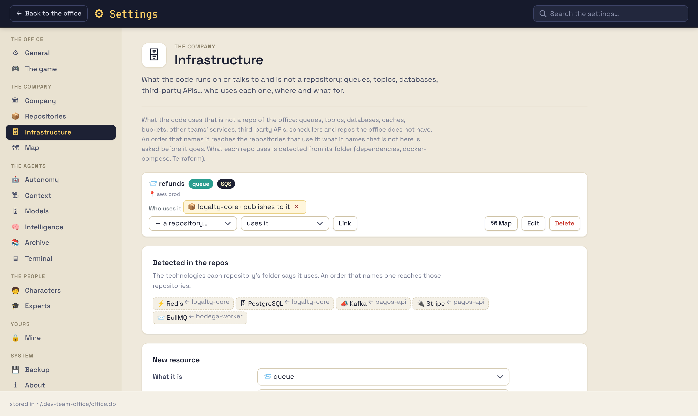

# Settings

**English** · [Español](settings.es.md)

Everything you set up in the office lives in one place: the **settings area**. Open it with **⚙** (top right of the game) or `c`; `Esc` or **← Back to the office** returns. It is a page of its own, not a dialog over the game, and it has an address: `http://127.0.0.1:4317/#settings/<section>` opens a section directly, and the browser's back button works.

- **The menu** on the left groups the sections. On a phone it becomes a picker at the top.
- **The search** (top right) finds a section by its name, by what it is for or by the words of what it holds ("kafka", "tokens", "herdr"); Enter goes to the first one.
- **Changes apply as you make them**, and the office uses them at once. Only **Characters** and **Models**, which you edit as a draft, have a **Save** button at the bottom.
- The terminal game has its own, smaller settings (`c`), on the same data: the everyday ones (language, zone and city, weather, the log, auto-compaction, herdr, the default model profile), the projects, the repositories (always asking which project) and the characters. Its General tab gives this area's address for the rest.

## The sections

| Group | Section | What is there |
|---|---|---|
| The office | **General** | The language (English or Spanish: it changes everything live, in the browser, the terminal and the log), the company's time zone (type a city, a region or a country) and its city (for the weather, the sun and the moon), and whether the weather is real or simulated |
| | **The game** | The view (front, or isometric top-down), the style of its people (pixel art, or anime: a team of women), office life in the log, and this browser's sound and system notification when an agent waits for you |
| The company | **Company** | The company as it is, in one place: its standards (the CTO's: they go on top of every brief) and capacity, and its **areas**, each with its **projects**. A project's card shows its repositories (＋ one, already in that project), its people (🧑), the map (🗺), ✉ a brief, and ✎ its name, area, instructions, autonomy, time zone and city |
| | **Repositories** | One light row per repository, grouped by area and project, with ✉ prompt, 🗺 map, ✎ edit and 🗑. Adding or editing one opens its window: its full path (the harness it brings is detected as you type), its name, **its project (always asked)**, its agent, its kind, its instructions, what it uses of other repositories and, in Advanced, its executable and arguments. ⌕ **Pick a known one** lists the open sessions nobody registered |
| | **Map** | The [architecture map](company.md#the-architecture-map): areas, projects, repositories and infrastructure; relate repositories (🔗), 🔍 explore their relations in the code, and its review |
| | **Infrastructure** | The declared resources with who uses each one and how (link and unlink in place), what the repositories name and nobody declared yet (**Declare**), each repository's stack (click one: what it is for, where and how, from the code), and the form |
| The agents | **Autonomy** | Whether the analyst reviews each brief before it becomes work, and whether the agents work to the end without stopping to ask. Each project can have its own level (⚙ › Company) |
| | **Context** | Auto-compaction: on or off, and the limit (in thousands of tokens, or a share of the window; 400k tokens by default) |
| | **Models** | The model profiles: which model each role uses, for which harnesses, and the default profile |
| | **Intelligence** | The model the office leans on to judge (today, an order's impact), and the **narrator**: a fast, cheap model (Claude Haiku by default; a DeepSeek flash or any OpenAI-compatible API; Ollama; an agent's CLI) that says in one short sentence what each one did, on their card and in their bubble when a turn ends (off: by rules, from the log). Each with **🧪 Try it**, and a warning when something is missing (the key, the model, the agent's CLI). Keys go in the environment, never in the database |
| | **Archive** | Whether the archive's passages go on top of every brief, the search by meaning (embeddings, with Ollama or OpenAI) and the index (**↻ Index it again**) |
| | **Terminal** | herdr: open the agent in a pane, each subagent in its own pane, which way panes open, and which agent opens at start |
| The people | **Characters** | The people of the project you are watching, as a row of portraits; pick one to edit who they are (name, title, personality, style: how they answer you) and how they look (sex, colors, long hair, beard, glasses), with 🎲 random, ↺ back to default, ⬇ export and ⬆ import as a JSON file |
| | **Experts** | The subject matter experts: each one tied to a skill — picked from yours first (your private ones, your agents' personal folders, your Claude Code plugins), then the archive's and the projects', or another one typed — with what they know about, their look and their quick actions |
| Yours | **Mine** | Your private skills (installed in your personal folder of each agent, never in a repository) and your own tools (scripts your agents see as the MCP tool `my_<name>`). Agents cannot create them: only you |
| System | **Backup** | **⬇ Export / ⬆ Import** your settings as a JSON file (also `dev-team-office settings export\|import`), where the database is, and **⟲ Start over**: back to the first day the parts you choose (general settings, characters and experts, the company, the activity, the archive), after exporting them if you want |
| | **About** | The version that is running, its address, where it keeps its data, the docs and the game's keys |

**What a settings file carries:** the general settings, the areas and their projects with their instructions, autonomy and characters, the repositories with their instructions, kinds and relations, the infrastructure, the experts, your tools and **your skills with their files** (your private ones, the ones in your agents' personal folders, and the project skills your experts use). Not the history, the loops or the archive. Importing merges piece by piece: what the file brings replaces what is here, the rest stays, and what cannot be brought (a repository whose folder is not on this machine) is listed.

**Its skills go where you say:** when the file brings skills, the office asks before applying it — **in your personal folders** (every session of your agents has them), **in some repositories** (their `.claude/skills` or `.agents/skills`), or **nowhere**. A different skill already there is never overwritten: it is left as it was, and said. From the CLI: `settings import <file> --skills global|repos|none [--repos <repo>,…]`, and `settings export --no-skills` leaves them out.

## From the command line

`dev-team-office config` lists every general setting with its value; `dev-team-office config <key> <value>` changes one (from a terminal, also with the office running: it applies at once). On and off are `on`/`off`.

| Key | Values |
|---|---|
| `lang` · `theme` | `en`\|`es` · `pixel`\|`anime` |
| `timezone` · `city` | an IANA zone or `system` · a city of that zone's country, or `zone` (the zone's city) |
| `weather` · `log.life` | `on`\|`off`: the real weather · office life in the terminal log |
| `view.office` · `view.mode` · `view.floor` | the project you watch · `flat`\|`iso` · `office`\|`exec`\|`archive` |
| `standards` · `capacity` | the company's standards (`-` empties them) · briefs a project takes at once from a directive (1–20) |
| `autonomy.clarify` · `autonomy.autonomous` | `on`\|`off`: the analyst reviews each brief first · the agents work to the end without stopping to ask |
| `compact.auto` · `compact.at` | `on`\|`off` · the limit: tokens (`400k`) or a share of the window (`80%`) |
| `archive.push` · `archive.embeddings` · `archive.model` · `archive.url` | `on`\|`off` · `off`\|`ollama`\|`openai` · the embeddings' model and address |
| `intelligence.provider` · `.harness` · `.model` · `.url` · `.timeout` | `off`\|`agent`\|`anthropic`\|`openai`\|`ollama` · the agent whose CLI it uses · its model · its address · seconds (10–600) |
| `narrator.provider` · `.harness` · `.model` · `.url` · `.timeout` | the same, for the narrator (the fast model of the short sentences; `claude-haiku-5-5` by default with `anthropic`) |
| `herdr.launch` · `herdr.subagents` · `herdr.direction` · `herdr.startAgent` | `on`\|`off` · `on`\|`off` · `right`\|`down` · `auto`\|`none`\|a repository's id |

`dev-team-office departments`, `agents`, `character`, `architecture` and `settings export|import` cover the rest. Every command: [the full CLI](usage.md#the-full-cli).

## Environment variables

Everything above is kept in the database. These are read from the environment, when the office starts:

| Variable | What for |
|---|---|
| `DEV_TEAM_OFFICE_PORT` · `DEV_TEAM_OFFICE_HOST` | The HTTP and WebSocket port (4317) and interface (`127.0.0.1`); also `--port`, `--host` |
| `DEV_TEAM_OFFICE_SOCKET` | The Unix socket the integrations use (`~/.dev-team-office/office.sock`) |
| `DEV_TEAM_OFFICE_DB` | The database file (`~/.dev-team-office/office.db`) |
| `DEV_TEAM_OFFICE_LANG` | The language until one is saved in ⚙ (`en`, `es`) |
| `DEV_TEAM_OFFICE_WEATHER=off` · `DEV_TEAM_OFFICE_LOCATION` | No real weather (nor the city search) · the city or `lat,lon` of the weather when ⚙ sets none (otherwise the zone's city) |
| `DEV_TEAM_OFFICE_MODEL_KEY` | The key of the model in ⚙ › Intelligence (or `ANTHROPIC_API_KEY`, `OPENAI_API_KEY`) |
| `DEV_TEAM_OFFICE_EMBED_KEY` | The key of the search by meaning with OpenAI (or `OPENAI_API_KEY`) |
| `DEV_TEAM_OFFICE_CLAUDE_BIN` | Which `claude` the office launches |
| `DEV_TEAM_OFFICE_URL` · `DEV_TEAM_OFFICE_OFFICE` | For an integration or a command: the office's address, and the project its events go to |
| `DEV_TEAM_OFFICE_AUTOSTART=0` | Pi's extension does not start the office when a session opens (only `/office`) |
| `DEV_TEAM_OFFICE_SETUP_CLI=0` | `setup` does not call the agents' CLIs (Claude Code's plugin update) |

The installer has its own: [installation](installation.md#2-install). The office sets a few for the agents it launches (`DEV_TEAM_OFFICE_LAUNCHED`, `DEV_TEAM_OFFICE_SESSION`, `DEV_TEAM_OFFICE_BTW`…, and `PW_TEST_REPORTER` for the [E2E tests](e2e.md)): they are not for you to set.

## Where everything is kept

**Everything "local" comes from the time zone:** the date and time (the clock, lunch, day and night), the **country** and the city (from the IANA zone table, offline: `America/Santiago` → Chile, Santiago, −33.45, −70.67) and, with those coordinates, **the weather**. By default, the system's zone.

Everything is saved in an **SQLite** database (also from the CLI: `dev-team-office config`, `dev-team-office offices`): `~/.dev-team-office/office.db`, or the path in `DEV_TEAM_OFFICE_DB`. It uses `node:sqlite`, so there are no native dependencies, and the file has `0600` permissions. Its main tables:

- `areas`: the company's areas, with their instructions;
- `offices`: the projects (each one a floor), with their area, instructions and autonomy;
- `agents`: the registered repositories (each with its agent, kind and project);
- `relations`: what each repository uses of another, and how (yours, or found in the code);
- `projects`: each project folder's instructions;
- `components`: the components declared in each repository;
- `settings`: the general settings (`prefs`: language, style, time zone and city, weather, view, model profiles, autonomy, standards, capacity, archive, auto-compaction, intelligence, narrator and herdr) and each project's characters;
- `prompts`: the history of what you sent them and how it ended;
- `asks`: the side questions (btw) and their answers;
- `directives`: the executive floor's orders and how each part went;
- `knowledge` (with `knowledge_chunks`, `knowledge_fts` and `knowledge_gaps`): the archive, its passages for the search, and the searches that found nothing;
- `mine`: your private skills and your own tools;
- `systems`: the products of before (their projects and relations now; it stays empty);
- `loops`: the projects' loops, their criteria and how each step goes;
- `experts`: the subject matter experts and their skills;
- `resources`: the infrastructure on the map (where it lives and which repositories use it).

Databases from earlier versions migrate by themselves (the main office is added). `DEV_TEAM_OFFICE_LANG=es` picks the language until one has been saved.

If a `~/.dev-team-office/config.json` from earlier versions existed, it is imported the first time.

**Your Claude Code settings:** with auto-compaction on, the office keeps your limit in `~/.claude/settings.json` too (`env`: `CLAUDE_CODE_AUTO_COMPACT_WINDOW` or `CLAUDE_AUTOCOMPACT_PCT_OVERRIDE`, marked with `DEV_TEAM_OFFICE_COMPACT`), so the Claude Code sessions you open by hand **and their subagents** compact where you said. Only those variables, and never one you set yourself; `uninstall` takes them out.

Everything is validated before writing, applied live, and a foreign website cannot change anything.
