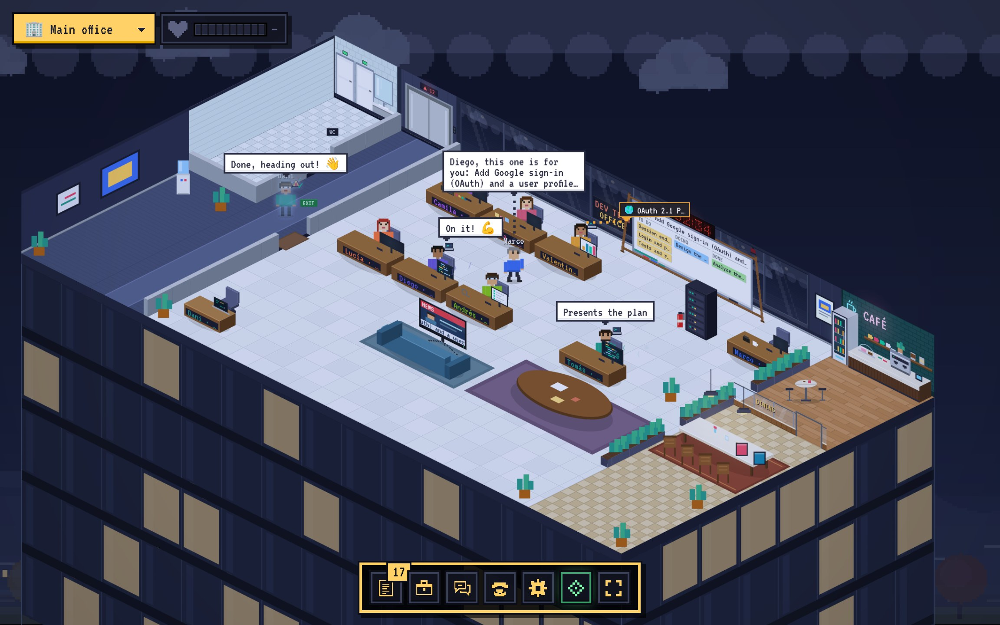

# La oficina

[English](the-office.md) · **Español**

Quién es quién en la oficina, qué representa cada personaje del trabajo de tu agente y la vida que la oficina tiene por su cuenta. Para saber cómo mirarla (el navegador, la terminal, el monitor), ver la [guía de uso](usage.es.md).

## El equipo

| Personaje | Rol | Qué del agente representa |
|---|---|---|
| Sofía | Product Owner | **Tú.** Tus pedidos (el prompt, un encargo desde la oficina) y tus preguntas al margen; el agente viene a tu escritorio con sus preguntas y a pedirte el OK. Ponle tu nombre y tu apariencia en ⚙ › Personajes |
| Valentina | Analista de negocio | Exploración, `WebSearch`/`WebFetch`, lectura de docs `.md`, subagentes `Explore`; historias de usuario, criterios de aceptación y prioridades (lo que un agente reportaría como PO) |
| Marco | Manager | Tablero de todos (`TodoWrite`/`TaskCreate`), entrega subtareas, te trae las preguntas del agente y te pide el OK, compactación |
| Tomás | Tech Lead / arquitecto | Lint, git, búsquedas en el código, planes (`Plan`), reviews, ayuda cuando algo falla |
| Andrés | QA | Archivos de test, `npm test`/`jest`/`pytest`/`playwright`…; si un test falla, le lleva el bug 🐞 al último dev que tocó código |
| Diego | Backend | Edición de código de servidor, migraciones, comandos de shell |
| Lucía | Frontend | `.tsx/.vue/.css/...`, `components/`, `pages/`, dev servers |
| Camila | Diseñadora | `.svg/.png`, `design/`, tokens, MCP de Figma |

Y dos **especialistas de visita**, sin escritorio propio: cuando el trabajo es suyo suben por el ascensor, se sientan en un escritorio libre mientras dura y se van cuando termina el turno del agente (un subagente de su rol también son ellos; un segundo al mismo tiempo es alguien nuevo de ese rol). Son personas, no extras: siempre los mismos, dibujados sólidos, y se personalizan en ⚙ › Personajes como el resto.

Y los **expertos** (SME, *subject matter experts*), los que tú creas: en ⚙ › Expertos, cada uno se **asocia a mano a una skill** (`pci-dss`, `kafka`…), con su nombre, de qué sabe y su aspecto. Cuando un agente usa esa skill (la herramienta `Skill` de Claude Code, `skill` de OpenCode, o leyendo los archivos de la skill, como Pi y Codex), su experto sube por el ascensor como un especialista de visita, se sienta en un escritorio libre con la skill en su badge (🎓 pci-dss) y se va cuando termina el turno. Los expertos son de toda la empresa y viajan en tu archivo de ajustes.

| Personaje | Rol | Qué del agente los hace subir |
|---|---|---|
| Rafa | DevOps/SRE | CI/CD (`.github/workflows/`, `.gitlab-ci.yml`, `gh run`), contenedores (`Dockerfile`, `compose.yaml`, `docker`), clústeres e IaC (`k8s/`, `helm`, `terraform`, `*.tf`), nubes y despliegues (`aws`, `gcloud`, `vercel`, `npm publish`, `deploy`), los MCP de Sentry, Datadog o de la nube |
| Inés | Seguridad | Escáneres (`npm audit`, `snyk`, `trivy`, `semgrep`, `gitleaks`, `pip-audit`…), `SECURITY.md`, `security/`, llaves y certificados (`.pem`, `.key`), `dependabot.yml`, el escaneo de secretos; subagentes que revisan seguridad (OWASP, vulnerabilidades, modelos de amenazas) |

## Lo que se ve

- **Pizarra kanban** en un atril, con los todos del agente (por hacer / en curso / hecho) y una barra de progreso. Encima tiene un **reloj digital de puntitos rojos**, con la hora de la oficina (su zona horaria).
- **Nuevo requerimiento:** tú (la PO) lo anuncias en el rincón de producto y se lo llevas al manager, y él se lo reparte a quien corresponda según de qué trata (pantallas → frontend, endpoints → backend, bugs → QA, colores y logos → diseño; si no está claro, al Tech Lead).
- **Subagente (`Task`/`Agent`):** si el personaje de ese rol está **libre**, lo toma él: Marco le lleva la tarjeta y hace el trabajo del subagente. Sólo cuando ya está **ocupado** (con otro subagente, o con el turno de su sesión) llega **alguien nuevo** de ese rol —los extras aparecen según la necesidad, no porque sí—, translúcido como un fantasma, con nombre propio y la camisa de su rol, por el **ascensor** al fondo del pasillo: entra por la puerta de la oficina y le aparece **un escritorio propio** en la fila de adelante, con su nombre y su proyecto (son siete; si hay más recién llegados se sientan en la mesa de reuniones). Cuando termina el subagente se despide, vuelve al ascensor y su escritorio se va con él.
- **Uso de herramientas:** el personaje teclea, **su pantalla se enciende con código que se escribe línea a línea** (sigue encendida, quieta, mientras piensa o se aleja con una tarea en curso; también los portátiles de los recién llegados), saltan glifos, y su burbuja dice **qué está haciendo en palabras** («Corriendo los tests», «Haciendo commit: «…»»), nunca el comando. El rack de servidores parpadea cuando trabaja backend.
- **Pausas de café sobre el trabajo:** en medio de una tarea van seguido a la cafetería y le cuentan a alguien en qué están trabados («Estoy editando api.js y no veo cómo manejar los errores»), o piensan en voz alta si nadie va, y vuelven **pensando** cómo resolverlo, hasta que en el escritorio les cae la idea. El trabajo de verdad los llama de vuelta en cualquier momento.
- **Caminan:** sus pies dan pasos (una zancada, el otro pie en el aire, la punta hacia donde van) y sus brazos se balancean.
- **Las charlas siguen el trabajo:** mientras hay una tarea hablan de quién hace qué, de cómo va el tablero, de quién se trabó o de que esperan tu OK.
- **La pizarra, expandida:** con tickets, al hacerle clic crece sobre la oficina y muestra las tareas como **post-its** en tres columnas (por hacer, en curso, hecho). Sin tickets, el clic abre un encargo nuevo.
- **El contexto, como barra de vida** ♥: arriba a la izquierda, cuánto contexto le queda al agente de la sesión enfocada, o al último que lo informa (lo hacen Claude Code, Pi y OpenCode, después de cada respuesta). Se vacía a medida que el contexto se llena, y se pone naranja, después roja; junto al % dice los tokens usados (`312k`: con una ventana de 1M el % casi no se mueve), y una muesca celeste marca dónde se compacta solo. Al pasar el mouse muestra el agente y los tokens. Mientras ningún agente lo informa, está ahí, en gris.
- **Autocompactación:** pasado tu tope (⚙ › Contexto: **400k tokens por defecto**, o una parte de la ventana), la oficina le pide al agente que compacte su contexto cuando termina su turno. Pi y OpenCode lo hacen solos; dentro de herdr, se escribe `/compact` en el pane del agente; los Claude Code que abre la oficina reciben el tope como propio (`CLAUDE_CODE_AUTO_COMPACT_WINDOW`); si no, la bitácora te avisa para que escribas `/compact`. Mientras compacta, la barra se pone celeste a rayas 🗜.
- **Un badge sobre cada personaje**, lo más chico posible, con lo que hace su agente en este momento: `✏️ cart.js`, `🧪 tests`, `💾 commit`, `🔍 total`, `🌐 docs.python.org`, `👥 ex-qa`, `🧰 deploy`. Se va cuando termina el turno de esa sesión (en las dos vistas del navegador y en el juego de la terminal).
- **Al pasar el mouse sobre alguien, o sobre su escritorio** (aunque no esté en él): una tarjeta dice **en qué está ahora** y **qué puedes hacer**: clic para su ficha, hablarle o pedirle algo, 👉 llamarle la atención, responder lo que te pregunta.
- **Cómo conversan:** una línea queda sobre la cabeza de alguien lo que tarda en leerse (una corta, poco; una larga, más). Una línea nueva nunca tapa una que todavía no se leyó: espera un momento, y sólo se dice la última que esperaba; un error o un aviso no esperan. En una conversación hablan de a uno: el siguiente contesta cuando se leyó la línea anterior, y quien habló suelta su burbuja. Las burbujas y los badges sobre las cabezas nunca se tapan entre ellos: si el lugar justo encima de una cabeza está ocupado, la burbuja sube o se corre, se desliza hasta ahí, y una línea de puntos pixel apunta a quien habla.
- **Su ficha** dice, bajo su estado, **lo último que hizo en una frase** (📝): concreta, de la bitácora real («Arregló el redondeo de pagos.js; un test sigue fallando»). Con un modelo narrador en ⚙ › Inteligencia (uno rápido: Claude Haiku, un DeepSeek flash…) la escribe el modelo, y al terminar un turno quien trabajó en él lo dice en su burbuja; sin modelo, la oficina lo dice por reglas.
- **Hablarles:** con `?` es una pregunta y la contesta su agente, como esa persona:
  - **el tech lead** averigua de qué repositorios le hablas (por su nombre, o el de su proyecto) y responde sobre ellos: qué es cada uno, qué usa, quién lo usa y en cuál está cada cosa;
  - **el manager** recibe **órdenes**: lo que le dices sin `?` va a trabajo de inmediato, al repositorio que nombres (o al único del proyecto), sin la revisión de la analista; con `?`, responde sobre el equipo, el plan y lo que está bloqueado;
  - **la PM** (Valentina, la analista) responde sobre el producto —quién lo usa, para qué sirve cada funcionalidad, alcance y prioridades—, nunca sobre el código.
- **La alfombra de la mesa de reuniones:** un clic en ella llama a una **🗣 daily** o a una **🔁 retro**. La retro muestra la última tarea del proyecto con los aprendizajes que la oficina sugiere de lo que dijo; los que dejas van al archivo (así los próximos encargos los traen) y el equipo se junta en la mesa a contarlos.
- **Error:** el personaje se sacude con chispas rojas y el Tech Lead se acerca a ayudar.
- **Permiso pendiente:** el manager va a tu escritorio (el de la PO) a pedirte el OK, levanta la mano y aparece un banner naranja. Si el agente te pregunta algo (`AskUserQuestion`), te trae la pregunta.
- **`Stop`:** confeti y todo el equipo celebra en la mesa de reuniones.
- **Sin actividad:** de vez en cuando alguien va por café o se sienta a ver tele.

## La vida de la oficina

Además, cada personaje tiene **vida propia**: necesidades que crecen con el tiempo (conversar, café, baño, consultar, imaginar) y una personalidad que decide qué hace cuando nadie le pide nada:

- **Sofía, Valentina y Camila** (PO, analista y diseñadora) son NPC del negocio: se sientan juntas y cotorrean, desde sus escritorios o juntándose en la cafetería o junto al sofá. Comentan lo que pasa en la oficina (la tarea en curso, quién se peleó con un error, quién vio todo en verde, el último incendio) y a veces de la charla sale una idea que Valentina o Camila le llevan a Marco, que la manda al backlog. Sofía eres tú: cotorrea, pero nunca decide nada por su cuenta.
- **Sueños:** Camila salta e imagina **unicornios 🦄 o arcoíris 🌈**; Andrés (QA) tiene **pesadillas con calaveras 💀**; Diego y Lucía sueñan con **pizza 🍕**. Aparecen en una nube de pensamiento en pixel art que brilla.
- **Diego, Lucía y Andrés**, mientras trabajan, a veces se paran a **consultar a Tomás** (el TL). Y **Tomás, el arquitecto**, a veces va a conversar con producto: datos con Valentina, mockups con Camila. A ti, la PO, no te pregunta: cuando el agente tiene una pregunta para ti, te la hace de verdad.
- **Marco** hace rondas para preguntar cómo van.
- **A las 13:00 el equipo se va a almorzar** al **comedor**, bajo la cafetería, con la hora de la oficina: pasan por la barra, entran al comedor y se sientan a la mesa larga (producto y el manager detrás, de frente; el equipo técnico delante, de espaldas), sin atravesar la mesa, y conversan hasta volver, a más tardar a las 14:00. Quien tiene un subagente trabajando almuerza en su escritorio 🥪, y si el agente necesita a alguien que está almorzando, deja el plato y vuelve a su puesto.
- **La oficina ocupa toda la planta:** su puerta (con el letrero de SALIDA) da a un **pasillo** con el **ascensor** al final, y al lado está el **baño 🚻**, una sala con dos cubículos y un lavamanos con espejo. Quien va entra caminando, toma un cubículo libre (su luz se pone roja) y después se lava las manos; si los dos están ocupados, el siguiente espera en el pasillo, inquieto. Frente al espejo se **cuchichea 🤫**: quienes coinciden ahí comentan, y las de producto a veces van juntas sólo para eso.
- **A veces el servidor se incendia 🔥:** suena la alarma, producto grita, Diego (o quien esté) toma el extintor, el equipo técnico lo apaga, reinicia los servidores y Tomás agenda el postmortem.
- **La cafetería** es la de una oficina moderna: neón, azulejos, máquina de espresso con vapor, vitrina con tortas, refrigerador de bebidas, una mesita alta y piso de roble. **Debajo, el comedor:** un muro bajo con vidrio y su letrero lo separa (se entra por la puerta o por el pasillo de abajo), piso de cerámica, alfombra, la mesa larga con mantel y dos lámparas colgantes que de noche alumbran la mesa.
- **La pared del fondo es de vidrio.** Detrás se ve la ciudad con la hora real: el sol cruza el cielo y se esconde detrás de los cerros, el cielo se pone rojizo al atardecer, de noche se prenden las ventanas de los edificios, los faroles y las luces de los autos, y sale la luna con su fase del día. **El cielo tiene vida:** pájaros en V, un avión de vez en cuando (su estela de día, sus luces de noche), un globo aerostático en días calmos, murciélagos al atardecer, estrellas fugaces y un satélite en noches despejadas; con lluvia no vuela nada.
- **La fecha cuenta:** la estación (según el hemisferio) cambia el parque, con flores en primavera, verde intenso en verano, hojas rojas que caen en otoño y árboles pelados en invierno. También cambian la nieve de los cerros y la hora del amanecer y del atardecer.
- **El clima es el de verdad** (el de la ciudad de cada oficina), de [Open-Meteo](https://open-meteo.com) (gratis y sin API key): nubes, neblina, llovizna, lluvia con gotas que resbalan por el vidrio, nieve, y tormenta con relámpagos que iluminan la oficina. Con frío, el vidrio se empaña. Cuando cambia el clima alguien lo comenta, con lluvia dan ganas de café y de tele, y a veces un trueno asusta a alguien. Sin conexión, la oficina inventa un clima según la estación. El clima también se ve en la tele. En la vista cenital el ventanal muestra sólo el **cielo** (sol, luna, estrellas, nubes, pájaros, lluvia): desde arriba ya ves la ciudad.
- **La sala de estar** tiene una tele en un trípode y un sofá. Cuando no tienen nada que hacer, los técnicos a veces se sientan a verla, de espaldas (con lluvia, más seguido). La tele muestra el clima, las noticias del equipo («EN VIVO: el equipo trabaja en…»), fútbol si alguien la está mirando, y **última hora** si se incendia el servidor.
- **De noche** las luces de la oficina siguen prendidas: el color se enfría apenas, y el neón, los monitores, las lámparas y los sueños brillan tenues.

"A veces" significa que hay un factor de azar: la necesidad se llena con el tiempo y además hay que ganar una tirada para que ocurra.

## Lo que hace el harness, en la oficina

La vida de la oficina no es sólo azar: cada señal del agente y de los subagentes de su harness empuja la necesidad o la reacción del personaje que corresponde, y el azar sólo decide el momento exacto.

| Señal del agente | Lo que pasa en la oficina |
|---|---|
| Se invoca el subagente de backend, frontend, QA… (`Task`/`Agent`, etapa de un pipeline) | Marco le lleva la carpeta y ese personaje se sienta a teclear mientras dure |
| Herramientas (`Edit`, `Bash`…) del rol | Teclea, su monitor muestra código; los builds y scripts del backend calientan el rack |
| Tests o gates que fallan (fuera de RED) | Andrés tiene **pesadillas 💀**; quien falló queda con dudas y pronto va a consultar a Tomás |
| RED de TDD | Fallar es lo esperado: no hay pesadilla |
| Tests en verde, fase GREEN | Andrés respira tranquilo (se le pasa la pesadilla) y el rack se enfría |
| Errores seguidos (sobre todo del backend) | El rack se recalienta, humea y **se incendia** («tanto error recalentó el servidor») |
| Mucho teclear seguido | Les da hambre: sueñan con **pizza 🍕**; y cansa: van por café |
| Termina un subagente | Se premia: con una pizza soñada o un café |
| Fases `ux`/`ui` o subagente de diseño | Camila se inspira: unicornios y arcoíris |
| Fase `arquitectura`/`adr` | Tomás va a preguntarle el alcance y los datos a Valentina |
| Fases `historia`/`criterios`/`requisitos` | Producto va a preguntarle a Tomás si es factible |
| El agente espera tu OK | Los que no trabajan aprovechan: café, conversación y tele |
| Tarea terminada (`Stop`) | Celebración en la mesa de reuniones, y los devs sueñan con la pizza del festejo |
| Tres errores seguidos del mismo rol | Ese personaje se **estresa 😰** (lo dice, suda, y su ficha dice «estresado (3 errores seguidos)»); el siguiente acierto lo calma |
| Al agente le queda menos de 25 % de contexto | Marco lo dice («Me queda poco contexto (12%)…») y él y quien esté trabajando **se cansan 🥱**: bostezan y quieren café. Al compactar, quedan como nuevos |

Todo esto sale también en la terminal de actividad, con la causa: `* Andrés tiene una pesadilla con una calavera 💀 (fallaron los tests)`.

La simulación es la misma en la terminal y en el navegador ([`public/sim.js`](../public/sim.js)), con reloj, hora del día y azar inyectables para probarla en tiempo simulado ([`test/sim.test.js`](../test/sim.test.js)).

## Estilos: pixel art o anime

⚙ › El juego › **Estilo** cambia cómo se ve la gente de la oficina. **Pixel art** es el equipo de siempre. **Anime** es otro elenco: un equipo de mujeres adultas al estilo del anime japonés, dibujadas con trazos vectoriales en vez de pixeles (ojos grandes, piernas largas), cada una con su nombre, su peinado y su ropa (faldas cortas, tops cortos, hombros al aire, medias altas); también las especialistas de visita, las expertas, las recién llegadas y la gente de la dirección y del archivo. Aquí no hay hombres: un look personalizado como hombre se dibuja y se nombra como mujer. Cada estilo guarda sus propias personalizaciones en ⚙ › Personajes. La terminal sigue dibujando en pixel art, con el elenco del estilo.

## El clima de afuera

La oficina le pide el clima a Open-Meteo cada 15 minutos, para cada oficina (las que están en la misma ciudad lo comparten). El lugar es la **ciudad** de la oficina. Una zona horaria abarca toda una región (en Chile, Concepción y Punta Arenas usan la de Santiago), así que la ciudad se elige en ⚙ › General › Ciudad: escribes y te sugiere las ciudades del país de la zona horaria, y la que eliges queda guardada con sus coordenadas. Cada proyecto puede tener la suya (⚙ › Empresa); las que heredan la zona horaria de la empresa heredan también su ciudad. Sin ciudad, se usa la de la zona horaria (sus coordenadas vienen en la tabla de zonas). `dev-team-office config city Concepción` hace lo mismo desde la terminal, y `DEV_TEAM_OFFICE_LOCATION` (un nombre o `-33.45,-70.65`) la fija para todas las oficinas que no tengan una. La ciudad decide también el sol, la luna y el clima simulado. Sólo se envía eso: lo que escribes para buscar la ciudad y las coordenadas para pedir el clima. Si se apaga en ⚙ › General (o con `DEV_TEAM_OFFICE_WEATHER=off`) no se consulta nada y el clima se simula según la estación. Las interfaces reciben el clima en el snapshot (`state.weather`) y, cuando cambia, en un mensaje `{ type: 'weather', weather, office }`.

## La escena: la capa entre el juego y lo que lo dibuja

El juego y su dibujo están separados: la simulación (`public/sim.js`) decide quién está dónde y qué pasa, y cada cuadro se convierte en una **escena** (`public/scene.js`): datos planos — la gente con su aspecto, pose, posición, burbuja y badge; el mundo que no se mueve (salas, puertas, la pared de vidrio, los muebles, en unidades del mundo y con su altura); la luz, el clima y la estación; la pizarra, el incendio, el ascensor. El canvas (vista frontal y cenital) y la terminal dibujan **sólo desde la escena**, y cualquier otro motor gráfico se conecta por el **SDK de renderers** (`public/sdk/`): se registra, dibuja la misma escena y dice qué hay bajo el puntero, y los clics del juego siguen funcionando, sin tocar el juego. `?renderer=plan` abre el renderer de referencia (un plano simple dibujado sólo con la escena) y `?renderer=blocks` uno en 3D con WebGL. El SDK está en [docs/rendering.es.md](rendering.es.md).
