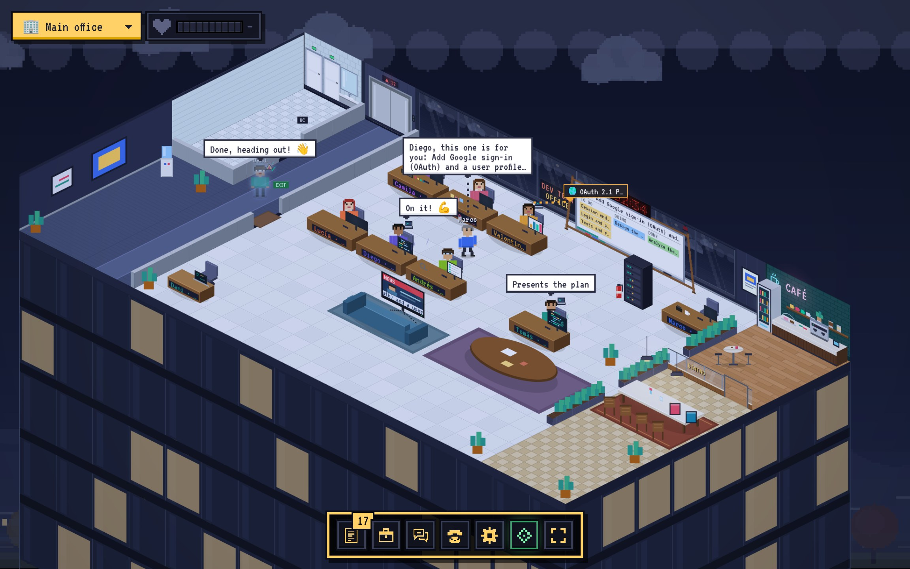

# The office

**English** · [Español](the-office.es.md)

Who is who in the office, what each character stands for in your agent's work, and the life the office has on its own. To learn how to watch it (the browser, the terminal, the monitor), see the [usage guide](usage.md).

## The team

| Character | Role | What of the agent they stand for |
|---|---|---|
| Sofía | Product Owner | **You.** Your requests (the prompt, a brief from the office) and your side questions; the agent comes to your desk with its questions and to ask for your OK. Give the character your name and look in ⚙ › Characters |
| Valentina | Business Analyst | Exploration, `WebSearch`/`WebFetch`, reading `.md` docs, `Explore` subagents; user stories, acceptance criteria and priorities (what an agent would report as PO) |
| Marco | Manager | The todo board (`TodoWrite`/`TaskCreate`), hands out subtasks, brings you the agent's questions and asks for your OK, compaction |
| Tomás | Tech Lead / architect | Lint, git, code searches, plans (`Plan`), reviews, help when something fails |
| Andrés | QA | Test files, `npm test`/`jest`/`pytest`/`playwright`…; if a test fails, he takes the bug 🐞 to the last dev who touched code |
| Diego | Backend | Editing server code, migrations, shell commands |
| Lucía | Frontend | `.tsx/.vue/.css/...`, `components/`, `pages/`, dev servers |
| Camila | Designer | `.svg/.png`, `design/`, tokens, the Figma MCP |

And two **visiting specialists**, without a desk of their own: when the work is theirs they come up by the elevator, sit at a hot desk while it lasts and leave when the agent's turn ends (a subagent of their role is them too; a second one at the same time is a newcomer of that role). They are people, not extras: always the same one, drawn solid, and customizable in ⚙ › Characters like the rest.

And **subject matter experts** (SME), the ones you make: in ⚙ › Experts, each one is **associated with a skill by hand** (`pci-dss`, `kafka`…), with their name, what they know about and their look. When an agent uses that skill (Claude Code's `Skill` tool, OpenCode's `skill`, or reading the skill's files, as Pi and Codex do), its expert comes up by the elevator like a visiting specialist, sits at a hot desk with the skill in their badge (🎓 pci-dss) and leaves when the turn ends. The experts are the whole company's and travel in your settings file.

| Character | Role | What of the agent brings them up |
|---|---|---|
| Rafa | DevOps/SRE | CI/CD (`.github/workflows/`, `.gitlab-ci.yml`, `gh run`), containers (`Dockerfile`, `compose.yaml`, `docker`), clusters and IaC (`k8s/`, `helm`, `terraform`, `*.tf`), clouds and deploys (`aws`, `gcloud`, `vercel`, `npm publish`, `deploy`), the Sentry/Datadog/cloud MCPs |
| Inés | Security | Scanners (`npm audit`, `snyk`, `trivy`, `semgrep`, `gitleaks`, `pip-audit`…), `SECURITY.md`, `security/`, keys and certificates (`.pem`, `.key`), `dependabot.yml`, secret scanning; subagents that review security (OWASP, vulnerabilities, threat models) |

## What you see

- A **kanban whiteboard** on an easel, with the agent's todos (to do / in progress / done) and a progress bar. On top there is a **red-dot digital clock** with the office's time (its time zone).
- **A new requirement:** you (the PO) announce it in the product corner and take it to the manager, and he hands it to whoever fits depending on what it is about (screens → frontend, endpoints → backend, bugs → QA, colors and logos → design; if unclear, the Tech Lead).
- **A subagent (`Task`/`Agent`):** if that role's own character is **free**, they take it: Marco brings them the card and they do the subagent's work. Only when they are **already busy** (with another subagent, or their session's turn) does a **newcomer** of that role come in — the extras come up when the work needs them, not just because — translucent like a ghost, with a name of their own and their role's shirt, by the **elevator** at the end of the hallway: they walk in through the office's door and a **desk of their own** appears for them in the front row, with their name and project (there are seven; more newcomers than that sit at the meeting table). When the subagent ends they say goodbye, walk back to the elevator and their desk goes with them.
- **Tool use:** the character types, their **screen lights up with code being written line by line** (it stays on, still, while they think or step away with a task going on; the newcomers' laptops too), glyphs pop out, and their bubble says **what they are doing in words** ("Running the tests", "Committing: “…”"), never the command line. The server rack blinks when backend is working.
- **Coffee breaks about the work:** in the middle of a task they often go to the café and tell someone what they are stuck on ("I'm editing api.js and I can't see how to handle the errors"), or think out loud if nobody comes, and walk back **thinking** how to solve it, until it clicks at the desk. Real work calls them back at any moment.
- **They walk:** their feet step (a stride, the other foot in the air, the toes pointing the way) and their arms swing.
- **The chit-chat follows the work:** while there is a task they talk about who is doing what, how the board is going, who got stuck or that they are waiting for your OK.
- **The whiteboard, expanded:** with tickets on it, clicking it grows it over the office and shows the tasks as **post-its** in three columns (to do, doing, done). Without tickets, the click opens a new brief.
- **The context, as a health bar** ♥: at the top left, how much context the focused session's agent has left, or the latest one that reports it (Claude Code, Pi and OpenCode do, after each answer). It empties as the context fills up, turning orange, then red; next to the % it says the tokens used (`312k`: a 1M window barely moves the %), and a light-blue notch marks where it compacts by itself. Hovering it shows the agent and the tokens. Until an agent reports it, it is there, grey.
- **Auto-compaction:** past your limit (⚙ › Context: **400k tokens by default**, or a share of the window), the office asks the agent to compact its context when its turn ends. Pi and OpenCode do it themselves; inside herdr, `/compact` is typed in the agent's pane; the Claude Code sessions the office opens get the limit as their own (`CLAUDE_CODE_AUTO_COMPACT_WINDOW`); otherwise the log tells you to type `/compact`. While it compacts, the bar turns striped light blue 🗜.
- **A badge over each character**, as small as it gets, with what their agent is doing right now: `✏️ cart.js`, `🧪 tests`, `💾 commit`, `🔍 total`, `🌐 docs.python.org`, `👥 ex-qa`, `🧰 deploy`. It goes when that session's turn ends (in the browser's two views and in the terminal game).
- **Hovering someone, or their desk** (even when they are away from it): a card says **what they are on right now** and **what you can do**: click for their card, talk to them or ask for something, 👉 get their attention, answer what they ask you.
- **How they talk:** a line stays over someone's head for as long as it takes to read it (a short one briefly, a long one longer). A new line never covers one that has not been read yet: it waits a moment, and only the latest one waiting is said; an error or a warning does not wait. In a conversation they speak one at a time: the next one answers when the previous line has been read, and the one who spoke lets their bubble go. The bubbles and the badges over people's heads never cover each other: when the place right over a head is taken, a bubble moves up or to the side, glides there, and a dotted pixel leader points at who is speaking.
- **Their card** says, under their state, **what they did lately in one sentence** (📝): concrete, from the real log ("Fixed the rounding in pagos.js; a test still fails"). With a narrator model in ⚙ › Intelligence (a fast one: Claude Haiku, a DeepSeek flash…) the model writes it, and when a turn ends whoever worked in it says it in their bubble; without one, the office says it by rules.
- **Talking to them:** with `?` it is a question and their agent answers it, as that person:
  - **the tech lead** finds which repositories you are talking about (by their name, or their project's) and answers about them: what each one is, what it uses, who uses it, and in which one each thing is;
  - **the manager** takes **orders**: what you tell him without `?` goes to work right away, to the repository you name (or the project's only one), without the analyst's review; with `?`, he answers about the team, the plan and what is blocked;
  - **the PM** (Valentina, the analyst) answers about the product — who uses it, what each feature is for, scope and priorities — never about the code.
- **The meeting table's rug:** click it to call a **🗣 daily** or a **🔁 retro**. The retro shows the project's last task with the learnings the office suggests from what it said; the ones you keep go to the archive (so the next briefs bring them) and the team gathers at the table to tell them.
- **An error:** the character shakes with red sparks and the Tech Lead comes over to help.
- **A pending permission:** the manager goes to your desk (the PO's) to ask for your OK, raises his hand and an orange banner shows up. If the agent asks you something (`AskUserQuestion`), he brings you the question.
- **`Stop`:** confetti, and the whole team celebrates at the meeting table.
- **No activity:** every now and then someone goes for coffee or sits down to watch TV.

## Office life

On top of that, each character has **a life of their own**: needs that grow over time (talking, coffee, bathroom, consulting, imagining) and a personality that decides what they do when nobody asks them for anything:

- **Sofía, Valentina and Camila** (PO, analyst and designer) are the business NPCs: they sit together and chit-chat, from their desks or meeting at the café or by the sofa. They talk about what is going on in the office (the current task, who fought with an error, who saw everything green, the last fire) and sometimes an idea comes out of the chat that Valentina or Camila take to Marco, who sends it to the backlog. Sofía is you: the character chats, but never decides anything on its own.
- **Dreams:** Camila jumps and imagines **unicorns 🦄 or rainbows 🌈**; Andrés (QA) has **nightmares about skulls 💀**; Diego and Lucía dream of **pizza 🍕**. They show up in a glowing pixel-art thought cloud.
- **Diego, Lucía and Andrés**, while working, sometimes get up to **consult Tomás** (the TL). And **Tomás, the architect**, sometimes goes to talk with product: data with Valentina, mockups with Camila. He does not ask you, the PO: when the agent has a question for you, it really asks.
- **Marco** makes rounds to ask how things are going.
- **At 13:00 the team goes to lunch** in the **dining room**, below the café, by the office's time: they stop at the counter, go into the dining room and sit at the long table (product and the manager at the back, facing us; the technical team in front, from behind), without crossing the table, and chat until they go back, by 14:00 at the latest. Whoever has a subagent working has lunch at their desk 🥪, and if the agent needs someone who is having lunch, they leave the plate and go back to their spot.
- **The office takes the whole floor:** its door (with its EXIT sign) opens to a **hallway** with the **elevator** at its end, and next to it is the **bathroom 🚻**, a room with two stalls and a sink with its mirror. Whoever goes walks in, takes a free stall (its light turns red), then washes their hands; with both taken, the next one waits in the hallway, restless. At the mirror there is **whispering 🤫**: whoever meets there gossips, and the product team sometimes goes together just for that.
- **Sometimes the server catches fire 🔥:** the alarm goes off, product screams, Diego (or whoever is around) grabs the extinguisher, the technical team puts it out, restarts the servers and Tomás schedules the postmortem.
- **The café** is a modern office's: neon, tiles, an espresso machine with steam, a display case with cakes, a drinks fridge, a high table and an oak floor. **Below it, the dining room:** a low wall with glass and its sign separates it (you enter through the door or from the lower aisle), a ceramic floor, a rug, the long table with its tablecloth and two pendant lamps that light the table at night.
- **The back wall is glass.** Behind it you see the city at the real time: the sun crosses the sky and sets behind the hills, the sky turns reddish at sunset, at night the buildings' windows, the street lamps and the car lights come on, and the moon rises with the day's phase. **The sky has life:** birds in a V, a plane now and then (its contrail by day, its lights at night), a hot-air balloon on calm days, bats at dusk, shooting stars and a satellite on clear nights; nothing flies in the rain.
- **The date matters:** the season (by hemisphere) changes the park, with flowers in spring, deep green in summer, red leaves falling in autumn and bare trees in winter. The snow on the hills and the times of sunrise and sunset change too.
- **The weather is the real one** (from each office's city), from [Open-Meteo](https://open-meteo.com) (free, no API key): clouds, fog, drizzle, rain with drops sliding down the glass, snow, and storms with lightning that lights up the office. When it is cold, the glass fogs up. When the weather changes someone comments on it, rain makes people want coffee and TV, and sometimes thunder scares someone. Offline, the office makes up a weather by season. The weather also shows on the TV. In the top-down view the glass wall shows only the **sky** (sun, moon, stars, clouds, birds, rain): from up there you already see the city.
- **The living room** has a TV on a tripod and a sofa. When they have nothing to do, the technical people sometimes sit down to watch it, from behind (more often when it rains). The TV shows the weather, the team news ("LIVE: the team is working on…"), football if someone is watching, and **breaking news** if the server catches fire.
- **At night** the office lights stay on: the color barely cools down, and the neon, the monitors, the lamps and the dreams glow faintly.

"Sometimes" means there is a random factor: the need fills up over time and then a roll has to be won for it to happen.

## What the harness does, in the office

Office life is not only chance: each signal from the agent and its harness's subagents pushes the matching character's need or reaction, and chance only decides the exact moment.

| Agent signal | What happens in the office |
|---|---|
| The backend, frontend, QA… subagent is invoked (`Task`/`Agent`, a pipeline stage) | Marco brings them the folder and that character sits down to type for as long as it lasts |
| The role's tools (`Edit`, `Bash`…) | They type, their monitor shows code; backend builds and scripts heat up the rack |
| Failing tests or gates (outside RED) | Andrés has **nightmares 💀**; whoever failed is left with doubts and soon goes to consult Tomás |
| TDD RED | Failing is expected: no nightmare |
| Green tests, GREEN phase | Andrés breathes easy (the nightmare goes away) and the rack cools down |
| Repeated errors (especially backend's) | The rack overheats, smokes and **catches fire** ("so many errors overheated the server") |
| Lots of typing in a row | They get hungry: they dream of **pizza 🍕**; and tired: they go for coffee |
| A subagent finishes | They reward themselves: with a dreamed pizza or a coffee |
| `ux`/`ui` phases or a design subagent | Camila gets inspired: unicorns and rainbows |
| `architecture`/`adr` phase | Tomás goes to ask Valentina about the scope and the data |
| `story`/`criteria`/`requirements` phases | Product goes to ask Tomás whether it is feasible |
| The agent awaits your OK | Those not working take the chance: coffee, a chat and TV |
| Task finished (`Stop`) | A celebration at the meeting table, and the devs dream of the party pizza |
| Three errors in a row from the same role | That character gets **stressed 😰** (it says so, sweats, and their card says "stressed (3 errors in a row)"); the next success calms them down |
| The agent's context drops below 25 % | Marco says it ("I'm running out of context (12% left)…") and he and whoever is working **get tired 🥱**: they yawn and want coffee. When it is compacted, they are good as new |

All of this also shows in the activity terminal, with its cause: `* Andrés has a nightmare about a skull 💀 (the tests failed)`.

The simulation is the same in the terminal and in the browser ([`public/sim.js`](../public/sim.js)), with an injectable clock, time of day and randomness to test it in simulated time ([`test/sim.test.js`](../test/sim.test.js)).

## Styles: pixel art or anime

⚙ › The game › **Style** changes how the office's people look. **Pixel art** is the usual team. **Anime** is another cast: a team of adult women drawn in the style of Japanese anime, with vector strokes instead of pixels (big eyes, long legs), each one with her own name, hair style and outfit (short skirts, crop tops, bare shoulders, thigh-highs), the visiting specialists, the experts, the newcomers and the people of the executive floor and the archive too. There are no men in it: a look customized as a man is drawn and named as a woman there. Each style keeps its own customizations in ⚙ › Characters. The terminal keeps drawing in pixel art, with the style's cast.

## The weather outside

The office asks Open-Meteo for the weather every 15 minutes, for each office (the ones in the same city share it). The place is the office's **city**. A time zone covers a whole region (in Chile, Concepción and Punta Arenas use Santiago's), so pick the city in ⚙ › General › City: type and it suggests the cities of the time zone's country, and the one you pick is saved with its coordinates. Each project can have its own (⚙ › Company); the ones that inherit the company's time zone also inherit its city. Without a city, the time zone's is used (its coordinates are in the zone table). `dev-team-office config city Concepción` does the same from the terminal, and `DEV_TEAM_OFFICE_LOCATION` (a name or `-33.45,-70.65`) sets it for every office without one. The city also decides the sun, the moon and the simulated weather. Only that is sent: what you type to search for the city, and the coordinates to ask for the weather. If it is turned off in ⚙ › General (or with `DEV_TEAM_OFFICE_WEATHER=off`) nothing is queried and the weather is simulated by season. The interfaces get the weather in the snapshot (`state.weather`) and, when it changes, in a `{ type: 'weather', weather, office }` message.

## The scene: the layer between the game and what draws it

The game and its drawing are separate: the simulation (`public/sim.js`) decides who is where and what happens, and each frame becomes a **scene** (`public/scene.js`): plain data — the people with their look, pose, position, bubble and badge; the world that does not move (rooms, doors, the glass wall, the furniture, in world units with their height); the light, the weather and the season; the whiteboard, the fire, the elevator. The canvas (front and top-down views) and the terminal draw **only from the scene**, and any other graphics engine plugs in through the **renderer SDK** (`public/sdk/`): it registers itself, draws the same scene and says what is under the pointer, and the game's clicks keep working, without touching the game. `?renderer=plan` opens the reference renderer (a plain plan drawn only from the scene) and `?renderer=blocks` a 3D one in WebGL. The SDK is in [docs/rendering.md](rendering.md).
